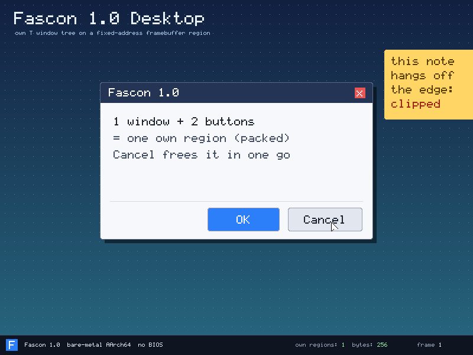

# Fascon 1.0

**English** | [日本語](#日本語)

Fascon is a Rust-like language with **no lifetime annotations**. Its memory safety is checked at compile time, and it compiles to readable C that GCC and Clang optimize well. Version 1.0 adds arenas with generation-tagged Ids, `own T` trees and fixed-address MMIO regions, and boots a small GUI kernel on AArch64 with no BIOS.



```rust
type ProcessId<@a: Process> = Id<@a>;          // an Id coloured by its arena: 32 bits, the split is the compiler's job

struct Process {
    pid: u32,
    parent: Option<ProcessId<@process>>,        // cycles are Ids, never references
    first_child: Option<ProcessId<@process>>,
    next_sibling: Option<ProcessId<@process>>,
}
arena @process: Process[64];                    // a static table in .bss

#[framebuffer]
mmio @fb: [[u32; 800]; 600] at 0x4800_0000;     // VRAM: the shape is the type, no raw pointers, no unsafe

struct Window { title: Str, ok: own Button, cancel: own Button }   // one allocation, freed in one go
```

## Extensions (same version 1.0): one language for BIOS, OS, GUI and applications on x86_64 and AArch64

```rust
fn main() {
    let task = create_process(100);              // no type annotations: inferred as Id<pcb_table>
    pcb_table[task].state = 1;                   // no `@`: the generation-verified .get_mut(task)
    com1 = b;                                    // port_io: x86_64 `out dx, al`, AArch64 → PL011 MMIO
    let data = own_alloc(Block);                 // zero-filled own Block, freed at the end of the scope
}
fn create_process(pid: u32) -> Id<pcb_table> { pcb_table.alloc(Pcb { pid: pid, state: 0 }).unwrap() }
struct Pcb { pid: u32, state: u8 }               // declarations in any order (two-pass analysis)
arena pcb_table: Pcb[64];
bump_arena scratch: Node[256];                   // O(1) bulk release when the allocating function returns
port_io com1 at_port 0x3f8;
```

- **Type inference** without annotations (F0282 eradicated), **names without `@`**, **free declaration order** (F2104 only for names declared nowhere).
- **bump_arena**: allocation advances a top; every exit of the allocating function rewinds it with one store. Ids are 64-bit generation-tagged, so a stale Id is still caught.
- **port_io**: the x86 I/O port space, separate from MMIO. `--target x86_64` emits `in` / `out`; `--target aarch64` remaps to MMIO (COM1 → the PL011).
- **own_alloc(T)**: dynamic allocation by type name, no generics; own children are zero-filled and packed into the same block.
- **Automatic reframing** (`#![reframing(rust)]` or `--reframing=rust`): ordinary Rust syntax (`static mut` + `#[link_section]`, `arena!` / `bump_arena!` / `port_io!` / `own_alloc!`, `println!` formatting, `unsafe`, `pub`, char literals, lifetimes, `while let`) is rewritten into Fascon and checked by Fascon's rules. `--emit-strict-fascon` writes the fully typed, desugared "functional-safety review" form, which compiles back to the same C.
- **Virtual BIOS**: `fascon bios app.fsc` builds a QEMU `-bios` image for x86_64 (reset vector → long mode → kernel) and for AArch64 (flash → RAM) from one source; `fascon qemu app.fsc --target x86_64` boots it.
- **Speed unchanged**: existing programs compile to the same C as 1.0.0 (`tools/compare_c.py`).

See [docs/SPEC-1.0-EXT.md](docs/SPEC-1.0-EXT.md) and the examples `gui_dual.fsc`, `bios_dual.fsc`, `rust_style.rs`, `app_wordfreq.fsc`, `own_callbacks.fsc`.

## How it stays safe without lifetimes

1. **References are second-class.** They appear only as parameters and `if let` / `match` bindings and can never be stored, so they die inside the block that made them (F0515).
2. **Ids are coloured by their arena.** An `Id<@file>` cannot be used with `@process` (F2101); `type FileId<@a: File>` checks the element type (F2102).
3. **Generation tags.** An Id is [generation 32−K | index K], with K chosen from the arena's capacity (65,536 slots → 16 | 16; 64 slots → 26 | 6), so every arena lasts for about 2.1–4.3 billion allocations. Freeing a slot bumps its generation, so a stale Id gives `None` instead of someone else's data (no ABA). Exhausted slots retire instead of wrapping.
4. **No branch on an unproven Id.** The index is masked into a table of 2^K + 1 slots, so no Id can address outside it. A read through an unproven Id only sets a latch, a write lands on a sentinel slot, and the program stops at the next commit point (before a call, output or return) with memory intact.

Checks that can be proven at compile time disappear from the C, and the rest do not branch: in the example kernel 9 of 50 generation checks are proven away, 34 are branch-free and the remaining 7 are the `Option` lookups the source branches on itself. `for id in @task { total += @task[id].vruntime; }` becomes one straight, unrolled scan of the table (`examples/vruntime_scan.fsc`), and the VRAM wallpaper loop compiles to the same NEON code as a hand-written raw-pointer loop.

**November 2026 update (version unchanged).** Table scans no longer branch per slot. A general `for id in @a` reads a live bitmap one 64-slot word at a time and finds the next live slot with ctz (TZCNT on x86-64, RBIT + CLZ on AArch64). Filtered counts, filtered sums and min / max with their Id become branch-free masked scans, and commit points move out of fixed-trip loops. Each arena table keeps its bookkeeping in a 128-byte block of its own, and `#[repr(align(N))]` aligns structs. Arenas sit in a 2 MiB-aligned section: on the BSP that is one 1 GiB block or 2 MiB blocks with the contiguous hint, and on Linux PCs `madvise(MADV_HUGEPAGE)`. An `own` value that never leaves its function goes to a stack-like frame region. On the benchmark the plain scan went from 0.74 / 0.71 to 0.63 / 0.57 ns per task (GCC / clang, 2.1 GHz). See [docs/PERF-1.0.md](docs/PERF-1.0.md).

**Columns (same version).** Every `for id in @a` reduction now reads a column holding just the values it reads, instead of the 32-byte slots: 8 or 4 bytes per task for sums and filtered sums, 1 bit for filtered counts, an 8-byte key for min / max picks. The compiler adds the columns, keeps them in step at every write (alloc, free, writes by Id, the end of a `get_mut` borrow or of a `match` / `if let` binding of a place in the slot, calls given `&mut`), and `@a.get(id)` still returns a pointer into the slot. On the benchmark the plain sum went from 0.45–0.54 to 0.10–0.21 ns per task and pick_next from 0.49–0.63 to 0.07–0.21 ns: under one cycle per task in every build (3.85 GHz). Loops that write a field a column reads pay for it; `--columns off` gives the earlier tables. See phase 4 of [docs/PERF-1.0.md](docs/PERF-1.0.md).

**True SoA (same version).** Fields that qualify now leave the slot and their column becomes the only copy, so a write to them is one store (`--columns mirrored` keeps the earlier mirrored columns). Against hand-written C (AoS) on one KVM host: bulk updates and overwrites of every task take 0.44–0.86× the C time with 60,000 tasks and 0.10–0.24× with 4 million (3.1–3.5× and 1.4–2.3× before); a write to runnable tasks only takes 0.97–1.11× with GCC and 1.22–1.90× with clang; reads stay under one cycle per task with 60,000 tasks and stream at the memory bandwidth limit with 4 million. Large bulk overwrites use non-temporal stores (`--nontemporal auto|on|off`). See phase 5 of [docs/PERF-1.0.md](docs/PERF-1.0.md).

**Fix (same version).** `match` / `if let` binding the whole value of a place that cannot be copied — a struct (`match @w[id].p { q => .. }`, a whole element, a local, a field behind a reference, a static), an array, or the whole of an `Option<own T>` — passed the check but generated broken C (it did not compile, or with `Option<own T>` corrupted the heap). Such a binding is now a reference to the place, as the specification says, and arrays used as whole values through a reference (`let h = a;`, `*a = b` with `a: &[T; N]`) copy the whole array. Replacing an `own` through a binding of its place is now error F0507 (assign the place instead). Other programs compile to the same C as before. See [vscode-extension/CHANGELOG.md](vscode-extension/CHANGELOG.md).

**Own fields and callbacks (same version).** Struct fields can be owning pointers of any value type, and functions can take function pointers:

```rust
struct MyContext { buffer: own i32, size: i32 }   // int32_t * in C, freed together with the struct
fn grow(c: &mut MyContext) { *c.buffer += c.size; } // `*` reaches the contents of a non-struct own
fn for_each(a: &mut [i32; 4], f: fn(&mut i32)) { for i in 0..4 { f(&mut a[i]); } }
```

A struct with own fields is move-only: moves, scope ends, overwrites, `drop` and arena frees free the owns inside (`fsc_drop_MyContext` → `fascon_own_free`), and F0382 / F0507 make use after move and double free unwritable. A callback that receives a reference must be *stack_only*: it may read and write through it and pass it on, but storing it in an arena, a static, the caller's places or an own, moving it into a by-value parameter or returning it is **F0520 — reference escape constraint violated**, reported with a root-cause timeline from the higher-order call to the escape. Calls through function pointers carry the union of the effects of the functions that can be passed there, so F2502 names a callback that would free an arena slot the caller has lent out. See section 10 of [docs/SPEC-1.0-EXT.md](docs/SPEC-1.0-EXT.md) and `examples/own_callbacks.fsc`; existing programs compile to the same C.

**fascon-gc and local owns (same version).** gc_arena Ids kept inside local `own T`, `Option<own T>`, structs with own fields and arrays of them (locals, by-value parameters, temporaries, return slots) are now roots of `gc_collect`; before, they were collected and read back as `None`. Every move, drop, overwrite and `.take()` clears the C variable before the storage goes away, a temporary leaves the roots right before the call or literal that takes it, and `#[on_drop]` runs while the value is still a root. Programs without gc_arena generate the same C. See section 5.3.1 of [docs/SPEC-1.0-UNIVERSAL.ja.md](docs/SPEC-1.0-UNIVERSAL.ja.md) and `tests/ok/gc_local_own_roots.fsc`.

## Quick start

Downloads: [Releases → v1.0.0](https://github.com/super-clutch/Fascon-programming-language/releases/tag/v1.0.0) has `fascon-1.0.0.vsix` (VS Code, every platform), the command-line archives for Windows, Linux and macOS, and `SHA256SUMS.txt`. The release page also has step-by-step usage in English and Japanese.

- **VS Code:** install `fascon-1.0.0.vsix` (Extensions → "…" → Install from VSIX), run "Fascon: Show Version and Tool Check", then "Fascon: Open a 1.0 Example (kernel / GUI / dual-architecture / BIOS / Rust style / app / callbacks)" and "Fascon: Boot in QEMU (target from settings; portable = BIOS-less AArch64)".
- **Command line:**

```text
fascon doctor                                   # what is installed, what is missing
fascon qemu examples/kernel_core.fsc            # Mission 1: multi-arena kernel, ABA check, boots with no BIOS
fascon qemu examples/gui_desktop.fsc            # Mission 2: GUI on ramfb
fascon qemu examples/gui_desktop.fsc --screenshot shot.png --frames 3
fascon build examples/kernel_core.fsc           # build/kernel_core.fascon.c + fascon2_rt.h
fascon bios examples/bios_dual.fsc              # x86_64 + AArch64 virtual-BIOS images from one source
fascon qemu examples/gui_dual.fsc --target x86_64    # the same GUI on x86_64 (Fascon virtual BIOS)
fascon run examples/rust_style.rs               # plain Rust syntax through automatic reframing
fascon run examples/own_callbacks.fsc           # own fields (own i32), moves and callbacks (stack_only / F0520)
fascon build examples/rust_style.rs --emit-strict-fascon   # build/rust_style.strict.fsc
```

Booting in QEMU needs QEMU and LLVM (clang + ld.lld): `winget install --id SoftwareFreedomConservancy.QEMU -e` and `winget install --id LLVM.LLVM -e` on Windows, `brew install llvm lld qemu` on macOS, `apt install clang lld qemu-system-arm qemu-system-x86` on Debian/Ubuntu.

## Documentation

- [Specification](docs/SPEC-1.0.md) — type rules, generated C, QEMU runs, benchmark, guarantees and limits
- [Extensions](docs/SPEC-1.0-EXT.md) — inference, names without `@`, two-pass analysis, bump_arena, port_io, own_alloc, reframing, the strict form, the virtual BIOS
- [Kernel extensions (Japanese)](docs/SPEC-1.0-KERNEL.ja.md) — steps 1 to 4 are implemented: preemption (`irq`, `critical`, `task_arena`), storage (`#[wire]`, `dma`, virtio-blk), networking (virtio-net) and user space (`user_mem`, `syscall`, `trap`); examples `examples/kernel_preempt.fsc`, `kernel_storage.fsc`, `kernel_net.fsc`, `kernel_user.fsc`
- [SMP extension of Fascon 1.0 (Japanese)](docs/SPEC-1.0-SMP.ja.md) — `shared arena`, `chan`, `spawn_on`, `par()`; example `examples/smp_kernel.fsc` (QEMU `-smp 4` and the PC)
- [Universal OS specification](docs/SPEC-1.0-UNIVERSAL.md) ([Japanese, full](docs/SPEC-1.0-UNIVERSAL.ja.md)) — `--target rtos` / `--target generic-os` (64-bit Ids, per-CPU magazines, RCU, PAN/LDTR, PAC/BTI, guard pages, W^X), **fascon-gc** (`gc_arena`, precise GC with type descriptors, F2621–F2625), package safety labels, the standard HAL, `board.toml` real-hardware images (`fascon build --board`, spin table / PSCI / IPI, non-coherent DMA, `bus_addr`), board packages under `boards/`
- [Integration of multi-core, interrupts, user space and fascon-gc (November 2026)](docs/SPEC-1.0-INTEGRATION.md) — `spawn_on` with `irq` / `task_arena` / `dma_arena` / `syscall` / `trap` (F2614 retired), 4 KiB `user_mem` with demand paging and one address space per task (ASID / CR3), EL0 and ring 3 processes on every core with TOCTOU-free system calls, panic stop on every core (SGI / NMI), fascon-gc roots for temporaries and channel contents, the multi-core x86_64 virtual BIOS, and compile-and-link checks for ARMv7 / MIPS64 / RISC-V64 (`tools/cross_check.py`)
- [Floats, masked column RMW, GPU offload and the HPC profile](docs/SPEC-1.0-HPC.md) ([Japanese](docs/SPEC-1.0-HPC.ja.md)) — `f32` / `f64` with `#[fast_math]` float True-SoA columns, branch-free masked column updates, `gpu_arena` with `GpuBuf` / `GpuFence` through `fascon_plat_gpu_*`, and `--target hpc` (pinning, NUMA binding, F3901–F3903)
- [Usage](docs/USAGE-1.0.md) — VS Code commands, CLI, troubleshooting
- [Benchmark results](bench/RESULTS.md)
- [Branch-free traversal, cache-line layout, huge pages and columns (November 2026)](docs/PERF-1.0.md)

## Honest limits

The checks cover code written in Fascon. They do not cover hardware faults (a bit flip in RAM), the hand-written C and assembly of the BSP and runtime, or an `mmio` declaration whose address does not match the hardware. Stack depth is not limited. An arena is finite (about 2.1–4.3 billion allocations), and a latched fault stops at the next commit point rather than at the access itself. Files that use only 0.1 features are handled by the bundled 0.1.0 engine (`fascon-core`). The Windows, macOS and Linux arm64 binaries are cross-compiled; runs were checked on Linux x64, QEMU virt (AArch64) and QEMU pc (x86_64, Fascon virtual BIOS). The Windows build was run under Wine and the Linux arm64 build under qemu-user: for all 247 programs of `examples/` and `tests/` in five modes (the default, `--columns mirrored`, `--columns off`, `--nontemporal on`, `--lang ja`) they gave byte-identical C, or the same failure, as the Linux x64 build. The macOS build was not run, and none of the three was run on its own hardware. QEMU TCG has no PCID, so the PCID path of the x86_64 BSP is implemented but was not executed; ARMv7 and MIPS64 were compiled and linked, not run (see section 10 of [SPEC-1.0-INTEGRATION.md](docs/SPEC-1.0-INTEGRATION.md)).

## Building and testing

```text
cargo build --release                                  # Rust 1.74 or later, no external crates
python3 tests/run_tests.py target/release/fascon --qemu
```

License: MIT OR Apache-2.0, at your option (`LICENSE-MIT`, `LICENSE-APACHE`). Pull requests are generally not accepted, and the compiler core is maintained by the author; forks and extensions are welcome (see [CONTRIBUTING.md](CONTRIBUTING.md) for the intent of the project).

Three parts of the release are not built from the sources in this repository and are shipped in compiled or bundled form: `fascon-core` (the 0.1.0 engine, used only for files with 0.1-only syntax), `libmas_runtime.a` (the 0.1.0 runtime libraries under `runtime/<target>/` in the platform archives) and `vscode-extension/out/extension.js` (the 0.1.0 VS Code extension, bundled and minified). `extension.js` contains third-party packages (vscode-languageclient and others); their copyright and license notices are in [THIRD_PARTY_NOTICES.md](THIRD_PARTY_NOTICES.md).

---

## 日本語

Fascon は**ライフタイム注釈のない** Rust 風の言語です。メモリ安全性はコンパイル時に検査され、GCC / Clang がよく最適化できる読みやすい C に変換されます。1.0 では、世代タグ付き Id のアリーナ・`own T` のツリー・固定番地の MMIO リージョンが加わり、BIOS なしの AArch64 で小さな GUI カーネルが起動します。

### 拡張（版は 1.0 のまま）: x86_64 と AArch64 の BIOS・OS・GUI・一般アプリを 1 つの言語で

- **型推論**: `let task = create_process(100);` に型注釈は要りません（F0282 の根絶）。
- **`@` の廃止**: `pcb_table[task].state = 1;` は世代タグで検証する `.get_mut(task)` と同じ式です。古い `@名前` も使えます。
- **宣言順の自由化**: 2 パス解析（1 周目で名前を登録）。`main` を先頭に、構造体やアリーナを最後に書けます。
- **bump_arena**: 確保は先頭を進めるだけ、確保した関数のすべての出口で 1 回の格納で一括解放（O(1)）。Id は 64 ビットの世代付きなので、古い Id も検出されます。
- **port_io**: x86 の I/O ポート空間（MMIO とは別）。`--target x86_64` で `com1 = c;` が `out dx, al`、`--target aarch64` ではコンパイラが MMIO（COM1 → PL011）へ写します。
- **own_alloc(T)**: 型名を渡す動的確保（ジェネリクスなし）。own の子も 0 で作り、同じブロックに詰めます。
- **自動リフレーミング**（`#![reframing(rust)]` / `--reframing=rust`）: ふつうの Rust の構文を Fascon へ書き換え、Fascon の規則で検査します。`--emit-strict-fascon` で、型と検証付きのルックアップをすべて書いた「機能安全証明形態」を出力します（もう一度コンパイルすると同じ C）。
- **仮想 BIOS**: `fascon bios app.fsc` が 1 つのソースから x86_64（リセットベクタ → ロングモード → カーネル）と AArch64（フラッシュ → RAM）の QEMU `-bios` の像を作ります。
- **速さは同じ**: 既存のプログラムの生成 C は 1.0.0 と同じです（`tools/compare_c.py`）。

詳しくは [docs/SPEC-1.0-EXT.ja.md](docs/SPEC-1.0-EXT.ja.md) と、例 `gui_dual.fsc`・`bios_dual.fsc`・`rust_style.rs`・`app_wordfreq.fsc`・`own_callbacks.fsc` を見てください。

### ライフタイムなしで安全な理由

1. **参照は第二級。** 引数と `if let` / `match` の束縛にしか現れず保存できないので、作ったブロックの中で必ず死にます（F0515）。
2. **Id はアリーナで色分け。** `Id<@file>` は `@process` に使えません（F2101）。`type FileId<@a: File>` は要素型も照合します（F2102）。
3. **世代タグ。** Id は [世代 32−K | 添字 K] で、K はアリーナの容量から決まります（65,536 スロットなら 16 | 16、64 スロットなら 26 | 6）。どのアリーナも約 21〜43 億回の確保まで使えます。スロットを解放すると世代が進むので、古い Id は他人のデータではなく `None` になります（ABA なし）。使い切ったスロットは一周させずに引退させます。
4. **証明できない Id でも分岐しない。** 添字は 2^K + 1 スロットの表へのマスクなので、どんな Id も表の外を指せません。証明できない Id での読み出しはラッチを立てるだけ、書き込みは番兵スロットへ逸れ、次のコミット点（呼び出し・出力・戻りの直前）でメモリを壊さずに止まります。

コンパイル時に証明できた検査は C から消え、残りも分岐しません。例のカーネルでは世代検査 50 か所のうち 9 か所が証明で消え、34 か所は分岐なし、残る 7 か所はソース自身が分岐する `Option` のルックアップです。`for id in @task { total += @task[id].vruntime; }` は表を一直線に走査する展開済みのループになり（`examples/vruntime_scan.fsc`）、VRAM の壁紙ループは生ポインタで手書きしたループと同じ NEON のコードになります。

**2026-11 の改修（版は 1.0.0 のまま）。** 表の走査は、スロットごとに分岐しなくなりました。一般の `for id in @a` は生存ビットマップを 64 スロットの 1 語ずつ読み、次の生存スロットを ctz（x86-64 は TZCNT、AArch64 は RBIT + CLZ）で求めます。条件付きの個数・条件付きの総和・最小 / 最大とその Id は分岐のないマスク付きの走査になり、コミット点は回数の決まったループの外へ出ます。アリーナの表は管理情報を専用の 128 バイトのブロックに置き、`#[repr(align(N))]` で構造体の整列を指定できます。アリーナは 2 MiB 境界のセクションに置かれます。BSP では 1 GiB ブロック 1 枚か、連続ビット付きの 2 MiB ブロックで覆い、Linux の PC では `madvise(MADV_HUGEPAGE)` を掛けます。関数の外へ出ない `own` は、スタックと同じ動きのフレームリージョンに置きます。ベンチマークでは、素の走査が 1 タスク 0.74 / 0.71 → 0.63 / 0.57 ns（GCC / clang、2.1 GHz）になりました。詳しくは [docs/PERF-1.0.ja.md](docs/PERF-1.0.ja.md) にあります。

**列（版は同じ）。** `for id in @a` の集計は、32 バイトのスロットではなく、その集計が読む値だけを並べた列を読むようになりました。総和と条件付き総和は 1 タスク 8 か 4 バイト、条件付きの個数は 1 ビット、最小 / 最大の選択は 8 バイトの鍵です。列はコンパイラが足し、書き込みのたび（alloc・free・Id での書き込み・`get_mut` の借用やスロットの中の場所を束縛した `match` / `if let` の終わり・`&mut` を渡した呼び出し）に同期させます。`@a.get(id)` は今までどおりスロットへのポインタを返します。ベンチマークでは素の総和が 0.45〜0.54 → 0.10〜0.21 ns、pick_next が 0.49〜0.63 → 0.07〜0.21 ns になり、どのビルドでも 1 タスク 1 クロック未満です（3.85 GHz）。列が読むフィールドを書くループはその分を払います。`--columns off` で前の表に戻ります。詳しくは [docs/PERF-1.0.ja.md](docs/PERF-1.0.ja.md) のフェーズ 4 にあります。

**完全列化（True SoA、版は同じ）。** 条件を満たすフィールドはスロットから外れ、列が唯一の正本になったので、そのフィールドへの書き込みはストア 1 回です（`--columns mirrored` で以前の写しの列）。1 台の KVM のホストで手書きの C（AoS）と比べると: 全タスクの一括更新と上書きが、6 万タスクで C の 0.44〜0.86 倍、400 万タスクで 0.10〜0.24 倍の時間（以前は 3.1〜3.5 倍と 1.4〜2.3 倍）、実行可能なタスクだけの書き込みが GCC で 0.97〜1.11 倍・clang で 1.22〜1.90 倍、読み出しは 6 万タスクで 1 タスク 1 クロック未満のまま、400 万タスクではメモリ帯域の上限で流れます。大きな一括上書きは非時間的ストアです（`--nontemporal auto|on|off`）。詳しくは [docs/PERF-1.0.ja.md](docs/PERF-1.0.ja.md) のフェーズ 5 にあります。

**修正（版は同じ）。** コピーできない場所の値全体を `match` / `if let` で束縛すると（構造体: `match @w[id].p { q => .. }`・要素まるごと・ローカル・参照の先のフィールド・static、配列、`Option<own T>` の全体）、検査は通るのに壊れた C が出ていました（コンパイルできないか、`Option<own T>` ではヒープを壊す）。この束縛は仕様どおり場所への参照になり、参照を通して配列全体を値として使う書き方（`a: &[T; N]` の `let h = a;`・`*a = b`）も配列全体を写すようになりました。own の場所の束縛を通した own の差し替えはエラー F0507 になります（元の場所へ代入してください）。ほかのプログラムの C は以前と同じです。詳しくは [vscode-extension/CHANGELOG.md](vscode-extension/CHANGELOG.md) にあります。

**own フィールドとコールバック（版は同じ）。** 構造体のフィールドに、どんな値の型でも所有権付きポインタとして持てるようになり、関数は関数ポインタを受け取れます。

```rust
struct MyContext { buffer: own i32, size: i32 }   // C では int32_t *。構造体と一緒に解放される
fn grow(c: &mut MyContext) { *c.buffer += c.size; } // 構造体でない own の中身は `*` で読み書きする
fn for_each(a: &mut [i32; 4], f: fn(&mut i32)) { for i in 0..4 { f(&mut a[i]); } }
```

own フィールドを持つ構造体は移動専用で、移動・スコープの終わり・上書き・`drop`・アリーナの free で中の own も解放されます（`fsc_drop_MyContext` → `fascon_own_free`）。F0382 / F0507 により、移動後の使用と二重解放は書けません。参照を受け取るコールバックは *stack_only* でなければならず、参照を通して読み書きし、さらに渡すのはよいのですが、アリーナ・static・呼び出し元の場所・own へ保存する、値渡しの引数へ移す、返すと **F0520 — 参照のエスケープ制約違反** になり、高階関数の呼び出しから逃げ先までの根本原因タイムラインが示されます。関数ポインタを通した呼び出しは、そこへ渡されうる関数の効果の和を持つので、呼び出し元が貸しているアリーナのスロットを解放しうるコールバックは F2502 で名指しされます。詳しくは [docs/SPEC-1.0-EXT.ja.md](docs/SPEC-1.0-EXT.ja.md) の 10 章と `examples/own_callbacks.fsc` にあります。既存のプログラムの C は以前と同じです。

**fascon-gc とローカルの own（版は同じ）。** ローカル・値渡しの仮引数・一時値・戻り値の入れ物の `own T`・`Option<own T>`・own フィールドを持つ構造体・その配列の中に置いた gc_arena の Id も、`gc_collect` の根になりました（以前は回収されて `None` に戻っていました）。移動・解放・上書き・`.take()` は記憶域が消える前に C の変数を NULL / 0 にし、一時値は受け取る呼び出し・リテラルへ渡す直前に根から外れ、`#[on_drop]` は値が根のまま走ります。gc_arena を使わないプログラムの C は変わりません。詳しくは [docs/SPEC-1.0-UNIVERSAL.ja.md](docs/SPEC-1.0-UNIVERSAL.ja.md) の 5.3.1 と `tests/ok/gc_local_own_roots.fsc` にあります。

### はじめかた

ダウンロード: [Releases → v1.0.0](https://github.com/super-clutch/Fascon-programming-language/releases/tag/v1.0.0) に `fascon-1.0.0.vsix`（VS Code、全 OS 用）、Windows・Linux・macOS 用のコマンドラインのアーカイブ、`SHA256SUMS.txt` があります。リリースのページには日本語と英語の手順も書いてあります。

- **VS Code:** `fascon-1.0.0.vsix` を入れ（拡張機能 →「…」→ VSIX からのインストール）、「Fascon: バージョンと必要なツールを確認」→「Fascon: 1.0 の例を開く（カーネル・GUI・両アーキテクチャ・BIOS・Rust 風・アプリ・コールバック）」→「Fascon: QEMU で起動（ターゲットは設定に従う。portable = BIOS なし AArch64）」。
- **コマンド:** 上の英語版と同じです。QEMU での起動には QEMU と LLVM（clang + ld.lld）が要ります。

### 資料

- [仕様書](docs/SPEC-1.0.ja.md) — 型規則・生成 C・QEMU での実行・ベンチマーク・保証と限界
- [拡張仕様書](docs/SPEC-1.0-EXT.ja.md) — 型推論・@ なし・2 パス・bump_arena・port_io・own_alloc・リフレーミング・厳格形・仮想 BIOS
- [カーネル拡張 設計仕様書](docs/SPEC-1.0-KERNEL.ja.md) — Step 1〜4 を実装済み: プリエンプション（`irq`・`critical`・`task_arena`）、ストレージ（`#[wire]`・`dma`・virtio-blk）、ネットワーク（virtio-net）、ユーザー空間（`user_mem`・`syscall`・`trap`）。例は `examples/kernel_preempt.fsc`・`kernel_storage.fsc`・`kernel_net.fsc`・`kernel_user.fsc`
- [SMP 拡張（Fascon 1.0）](docs/SPEC-1.0-SMP.ja.md) — `shared arena`・`chan`・`spawn_on`・`par()`。例は `examples/smp_kernel.fsc`（QEMU の `-smp 4` と PC）
- [ユニバーサル OS 仕様](docs/SPEC-1.0-UNIVERSAL.ja.md) — `--target rtos` / `--target generic-os`（64 ビット Id・Per-CPU マガジン・RCU・PAN/LDTR・PAC/BTI・守りページ・W^X）、**fascon-gc**（`gc_arena`・型記述子による正確な GC・F2621〜F2625）、パッケージの安全性のラベル、標準 HAL、board.toml による実機の像（`fascon build --board`・スピンテーブル / PSCI / IPI・非一貫 DMA・`bus_addr`）、`boards/` のボードのパッケージ
- [使い方](docs/USAGE-1.0.ja.md) — VS Code のコマンド・CLI・困ったとき
- [ベンチマークの結果](bench/RESULTS.md)
- [分岐のない走査・キャッシュラインの配置・大きなページ・列（2026-11）](docs/PERF-1.0.ja.md)
- [マルチコア・割り込み・ユーザー空間・fascon-gc の統合（2026-11）](docs/SPEC-1.0-INTEGRATION.ja.md) — `spawn_on` と `irq`・`task_arena`・`dma_arena`・`syscall`・`trap` の併用（F2614 は廃止）、4 KiB の `user_mem` と要求時ページング・タスクごとのアドレス空間（ASID / CR3）、全コアの EL0 / Ring 3 のプロセスと TOCTOU なしのシステムコール、パニック時の全コア停止（SGI / NMI）、fascon-gc の一時値とチャネルの中の根、マルチコアになった x86_64 の仮想 BIOS、ARMv7・MIPS64・RISC-V64 の翻訳とリンクの検査（`tools/cross_check.py`）

### 正直な限界

検査の対象は Fascon で書いたコードです。ハードウェアの故障（RAM のビット反転）、BSP とランタイムの手書きの C・アセンブリ、実機と食い違う `mmio` 宣言は対象外です。スタックの深さは制限していません。アリーナは有限（約 21〜43 億回の確保まで）で、ラッチで受けたフォールトはアクセスの場所ではなく次のコミット点で止まります。0.1 だけの機能を使うファイルは同梱の 0.1.0 エンジン（`fascon-core`）が処理します。Windows・macOS・Linux arm64 版はクロスビルドで、実行を確かめたのは Linux x64・QEMU virt（AArch64）・QEMU pc（x86_64、Fascon の仮想 BIOS）です。Windows 版は Wine で、Linux arm64 版は qemu-user で動かし、`examples/` と `tests/` の 247 本を 5 つのモード（既定・`--columns mirrored`・`--columns off`・`--nontemporal on`・`--lang ja`）で翻訳して、Linux x64 版と 1 バイトも違わない C（または同じ失敗）になることを確かめました。macOS 版は動かしておらず、3 つともそれぞれの実機では動かしていません。QEMU の TCG には PCID が無いので、x86_64 の BSP の PCID の道は実装してありますが動かしていません。ARMv7・MIPS64 は翻訳とリンクまでで、実行はしていません（[SPEC-1.0-INTEGRATION.ja.md](docs/SPEC-1.0-INTEGRATION.ja.md) の 10 節）。

ライセンス: MIT OR Apache-2.0（どちらか好きな方。`LICENSE-MIT`・`LICENSE-APACHE`）。プルリクエストは原則として受け付けず、コンパイラの中核は作者が保守します。フォークと拡張は歓迎します（趣旨は [CONTRIBUTING.md](CONTRIBUTING.md)）。

配布物のうち次の 3 つは、このリポジトリのソースからはビルドされず、コンパイル済みのバイナリ・バンドルとして同梱しています: `fascon-core`（0.1.0 のエンジン。0.1 だけの構文を使うファイルにだけ使います）、`libmas_runtime.a`（各プラットフォームのアーカイブの `runtime/<ターゲット>/` にある 0.1.0 のランタイムライブラリ）、`vscode-extension/out/extension.js`（0.1.0 の VS Code 拡張機能をバンドル・圧縮したもの）。`extension.js` には第三者のパッケージ（vscode-languageclient など）が含まれており、その著作権表示とライセンス文は [THIRD_PARTY_NOTICES.md](THIRD_PARTY_NOTICES.md) にあります。
