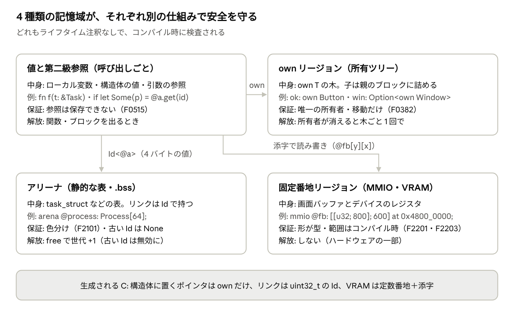
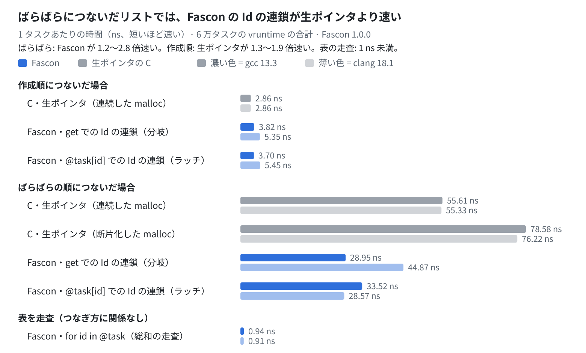
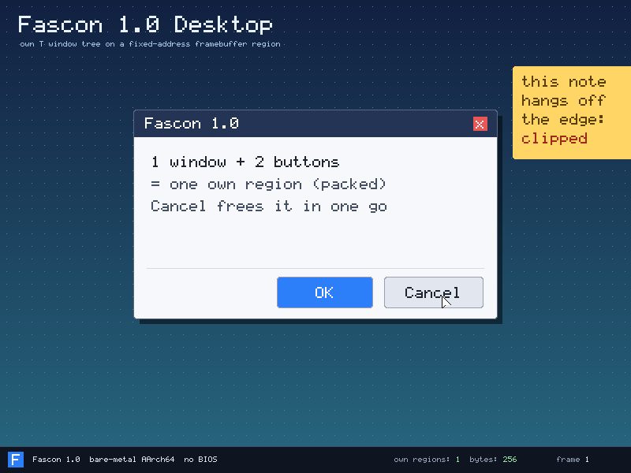
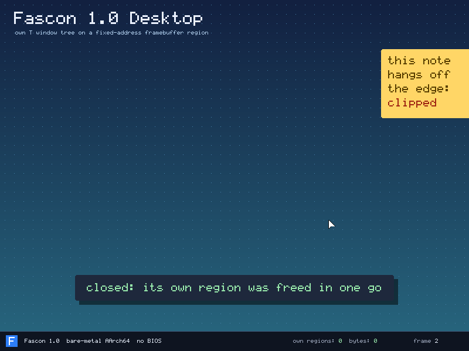

# Fascon 1.0 拡張仕様書 — マルチアリーナ・世代タグ・own T・固定番地リージョン

2026-11-06 · Fascon 1.0.0 · English: [SPEC-1.0.md](SPEC-1.0.md)

## 全体像



参照は構文ブロックの中だけで生き、長く残るリンクは own（親から子）・Id（表の中）・添字（固定番地）のどれかになります。どれも寿命に名前を付ける必要がありません。

## ミッション1 — エグゼクティブ・サマリー

Fascon 1.0 では、task_struct・struct file・inode のような双方向で循環する構造を、ライフタイム注釈を 1 文字も書かずに定義でき、メモリ安全性はコンパイル時に検査されます。それを支える規則は 3 つです。

1.  **構造体に参照を置けない（第二級参照・F0515）。** 長く残るリンクはすべて `Id<@アリーナ>` という 4 バイトの値で持ちます。参照は関数の引数と `if let` / `match` の束縛にしか現れず、寿命は書いた構文ブロックそのものなので、寿命に名前を付ける必要がありません。

2.  **Id はアリーナごとに色分けされる（F2101・F2102）。** `Id<@file>` を `@process` に渡すと型エラーです。`type FileId<@a: File> = Id<@a>` のような別名は、アリーナの要素型とも照合されます。

3.  **世代タグで古い Id を必ず見分ける。** Id は 32 ビットの「世代 32-K \| 添字 K」です。K = ceil(log2(容量)) はアリーナごとにコンパイラが決めるので、ソースに上限は書きません。65,536 スロットのアリーナはちょうど 16 \| 16、64 スロットの `@process` は 26 \| 6 になり、どのアリーナも約 21〜43 億回の確保まで使えます。解放のたびにそのスロットの世代が 1 進むので、古い Id で引くと `None` になります。生存を証明できない `@a[id]` は Id で分岐しません。古い Id の読み出しはラッチを立てるだけ、書き込みは番兵スロットへ逸れ、次のコミット点（呼び出し・出力・戻りの直前）でパニック 0x000D として止まります。同じスロットが再利用されても取り違え（ABA）は起きません。

例のカーネル `examples/kernel_core.fsc` で確かめた結果です。

| 項目                             | 結果                                                                               |
|----------------------------------|------------------------------------------------------------------------------------|
| アリーナ                         | `@process` 64・`@file` 256・`@inode` 128 スロット（計 23,168 バイト、2 MiB 境界の `.bss.fascon_arena`）。Id は 26 \| 6・24 \| 8・25 \| 7 ビット |
| 世代検査（50 か所）              | 9 か所は生存を静的に証明して省略、34 か所は分岐なし（番兵 + ラッチ）、7 か所はソースが None の腕を書く `Option` のルックアップ。`if (古い) panic()` は 1 か所もない |
| 境界検査                         | 実行時 4 か所、静的に省略 4 か所                                                   |
| ライフタイム注釈（`'` の数）     | 0                                                                                  |
| BIOS なしの QEMU（AArch64・EL1） | `FASCON-KERNEL-OK`、終了コード 0                                                   |
| テスト                           | `python3 tests/run_tests.py target/release/fascon --qemu` で 317 件すべて合格（RISC-V のボードの試験は `qemu-system-riscv64` があるときだけ動くので、無ければ 316 件）|

「100%」と言える範囲は、最後の「保証の範囲と限界」に書きました。宇宙線などによるビット反転、BSP の C とアセンブリ、`mmio` 宣言に書いた番地そのものの誤りは対象外です。

## 型規則

安全性は次の 6 つの規則で決まり、どれもライフタイム変数を使いません。参照の寿命は構文の入れ子そのもの、アリーナの生死は世代で表すので、検査はすべて決定可能です。

**1. アリーナの着色。** 別のアリーナの Id は別の名目型で、代入も比較もできません（F2101）。

```math
\frac{\Gamma \vdash e : \mathrm{Id}\langle @a \rangle \qquad @a : T[N]}{\Gamma \vdash @a[e] : T}
\qquad\qquad
a \neq b \;\Rightarrow\; \mathrm{Id}\langle @a \rangle \neq \mathrm{Id}\langle @b \rangle
```

**2. 種別境界つきの別名。** `type FileId<@x: File> = Id<@x>` は、要素型が File のアリーナだけを受け付けます（F2102）。

```math
\frac{@y : T[N] \qquad T \neq \mathit{File}}{\mathit{FileId}\langle @y \rangle \ \text{is ill-formed}}
```

**3. 第二級参照。** 値の型の文法に参照が無いので、参照を構造体・戻り値・Option・アリーナに入れる式は型を持ちません（F0515）。参照 `&T`・`&mut T` は引数（関数ポインタ型 `fn(&mut T)` の引数を含む）と `if let` / `match` の束縛にだけ現れ、作った構文ブロックの中で必ず死にます。コピーできない型（構造体・`own`、それらを含む配列や Option）の場所を束縛すると、束縛はその場所への参照になり（書き換えられる場所なら `&mut T`、そうでなければ `&T`）、束縛を通した書き込みは元の場所に届きます。コピーできる型（整数・`bool`・`Str`・Id、それらの配列や Option）の場所は値で束縛されます。`own` の場所の束縛は `&mut w.ok` と同じく own の中身を指すので、own そのものの差し替えは元の場所への代入で書きます（F0507）。

```math
\tau ::= \mathtt{u8} \mid \cdots \mid \mathtt{u64} \mid \mathtt{bool} \mid \mathtt{Str} \mid S \mid \mathtt{Option}\langle \tau \rangle \mid \mathtt{own}\ \tau \mid \mathrm{Id}\langle @a \rangle \mid [\tau ; n] \mid \mathtt{fn}(\pi_1, \dots, \pi_k) \to \tau
\qquad
\pi ::= \tau \mid \&\tau \mid \&\mathtt{mut}\ \tau
```

`own τ` は値の型ならなんでも所有できます（`own i32`・`own [u8; 4096]`・`own Str`・`own Option<own Node>`・`own S`）。参照・`()`・own の own・関数ポインタは所有できません（F0515 / F2301）。構造体でない own の中身は `*` で読み書きし（`*ctx.buffer += 1`）、`own S` のフィールドはそのまま読めます（`w.ok.label`）。関数ポインタ型は値の型で、引数 π は引数の位置なので参照を書けますが、戻り値 τ には書けません（F0515）。

**4. アリーナ効果。** 各関数 f に、読む・書く・解放するアリーナの集合 E(f) = (R, W, F) を、呼び出しグラフの最小不動点として割り当てます。`&mut @a[_]` が生きている間に a を触る関数を呼ぶこと、`&@a[_]` が生きている間に a を書くか解放する関数を呼ぶことを拒否します（F2502）。同じアリーナの 2 つのスロットを同時に可変で借りることも拒否します（F0499）。

```math
E(f) \;=\; \mathrm{local}(f) \;\cup \bigcup_{g \,\in\, \mathrm{callees}(f)} E(g)
```

**6. コールバックは stack_only（F0520）。** 関数ポインタの値は「関数の名前を値として使った場所」からしか生まれないので、コールバックになる関数 g はすべて分かります。g の参照引数 x ごとに、逃げ道の要約 Esc(g, x) を呼び出しグラフ上の最小不動点として求めます: Esc(g, x) ≠ ∅ ⇔ x（x から作った参照 `&mut x.f`・x の先の場所の束縛、x を包んだ値 `Some(x)`・構造体や配列のリテラル・`own x`、x を束縛したローカルを含む）が、戻り値・呼び出しより長く生きる場所（アリーナ・static・MMIO・ポート・別の参照の先）・own の所有リージョン・値渡しの引数・Esc ≠ ∅ の参照引数のどれかへ流れる。コールバックには stack_only(g) ⇔ ∀x. Esc(g, x) = ∅ を要求し、破れれば F0520 になり、その流れが根本原因のタイムラインとして示されます。`f(&mut a[i])` と呼ぶ高階関数 `for_each(a, f)` が貸す参照は、こうして呼び出しの区間 [call, ret] の中でだけ使われます。関数ポインタを通した呼び出しの効果は、そこへ渡されうる関数の効果の和なので（規則 4）、F2502 もコールバックについて成り立ちます。

```math
\mathrm{stack\_only}(g) \iff \forall x \in \mathrm{refparams}(g).\; \mathrm{Esc}(g, x) = \emptyset
\qquad
E(\texttt{f}(\ldots)) \;=\; \bigcup_{g \,\in\, \mathrm{cands}(\texttt{f})} E(g)
```

**5. 世代タグ。** Id は組 (g, i) を g · 2^K + i に詰めたもので、N スロットのアリーナでは K = ceil(log2 N) です。スロット i の世代を g_i とすると、ルックアップと解放は次のとおりです。Id を作れるのは `alloc`（g ≥ 1）と `validate` だけで、g_i は単調に増えて一周しないので、古い Id が再び一致することはありません。最後の世代 2^(32−K) − 1 に達したスロットは引退し、二度と貸し出されません。

```math
\mathrm{get}(g, i) = \begin{cases} \mathrm{Some}(\mathit{slot}_i) & g = g_i \ne 0 \\ \mathrm{None} & \text{otherwise} \end{cases}
\qquad
\mathrm{free}(i) : \; g_i \leftarrow g_i + 1 \quad (g_i = 2^{32-K} - 1 \Rightarrow \text{retire})
```

**検査の静的な省略。** `alloc` の直後、`if let Some(_) = @a.get(id)` の中、`for id in @a` の各反復の先頭では Id の生存が証明済みになり、その後に同じアリーナの解放効果が無い区間では世代検査を出しません。検査付きアクセスが通っても、その後のアクセスの証明にはなりません（その場で止まらないため。「32 ビット Id・ラッチ・総和の特殊化」を参照）。例外は own を持つ要素で、こちらはその場で止まります。添字は範囲解析で証明できれば境界検査を出しません。

| コード                | 拒否するもの                                                              |
|-----------------------|---------------------------------------------------------------------------|
| F0001                 | `'` を含むソース（ライフタイム注釈や文字リテラル）                        |
| F0382 / F0381         | 移動後の使用・初期化前の使用                                              |
| F0499 / F0502 / F0596 | 可変参照の重複・借用中の書き換え・共有参照からの書き込み                  |
| F0507                 | `own` フィールドから子を移動で取り出すこと、`*b` からコピーできない値を取り出すこと、own の場所の束縛を通して own を差し替えること |
| F0515                 | 参照を構造体・戻り値・Option・アリーナ・own に保存すること、関数ポインタ型の戻り値に参照を書くこと |
| F0520                 | コールバックが受け取った参照を外へ逃がすこと（保存・own への格納・包む・値渡しの引数へ移す・返す） |
| F0618                 | 関数でも関数ポインタ `fn(..)` でもないものを呼ぶこと                      |
| F2030                 | 自分自身を値として含む構造体（再帰は `Option<own T>` で書く）             |
| F2031 / F2032         | 形の正しくない `#[repr(align(N))]`（N は 1〜4096 の 2 の累乗）、16 バイトを超える整列の型を `own` に入れること |
| F2101 / F2102         | 別アリーナの Id の使用・種別境界に合わない別名                            |
| F2301                 | own が所有できないもの（`()`・`own own T`・関数ポインタ）への own        |
| F2201 / F2203         | 定数の範囲外添字・MMIO リージョンの重なり                                 |
| F2502                 | 借用中のアリーナへの書き込み・解放を含む関数の呼び出し                    |
| F2900                 | 0.1 専用の機能（spawn・chan・async・`#[isr]`）を 1.0 のファイルで使うこと |

## ミッション1 — カーネルのソースと「`'` ゼロ」の証明

`examples/kernel_core.fsc`（392 行）は、子→親・親→子リスト・Process→File→Inode・File→Process の逆リンクという循環グラフを 3 つのアリーナにまたがって持ち、`'` を 1 文字も使いません。型の定義とアリーナは次のとおりです。

```rust
type ProcessId<@a: Process> = Id<@a>;
type FileId<@a: File> = Id<@a>;
type InodeId<@a: Inode> = Id<@a>;

struct Inode { ino: u32, size: u64, open_count: u32 }

struct File {                                   // struct file 相当
    inode: InodeId<@inode>,                     // File → Inode
    pos: u64,
    refcnt: u32,                                // fork / dup で共有
    opener: ProcessId<@process>,                // File → Process（逆リンク）
}

struct Process {                                // task_struct 相当
    pid: u32,
    state: u8,
    exit_code: i32,
    parent: Option<ProcessId<@process>>,        // 子 → 親（循環）
    first_child: Option<ProcessId<@process>>,   // 親 → 子（侵入型リスト）
    next_sibling: Option<ProcessId<@process>>,
    fds: [Option<FileId<@file>>; NFDS],         // Process → File
    nfiles: u32,
}

arena @process: Process[64];
arena @file: File[256];
arena @inode: Inode[128];
```

終了したプロセスの子を init へ付け替える処理です（Linux の reparent と同じ動き）。Id は値なので、読んでから書くだけで参照を握り続けません。

```rust
fn exit_task(pid: ProcessId<@process>, code: i32, init: ProcessId<@process>) {
    for fd in 0..NFDS {
        close(pid, fd);
    }
    let mut cur = @process[pid].first_child;
    loop {
        match cur {
            Some(c) => {
                let next = @process[c].next_sibling;
                @process[c].parent = Some(init);
                @process[c].next_sibling = @process[init].first_child;
                @process[init].first_child = Some(c);
                cur = next;
            }
            None => {
                break;
            }
        }
    }
    @process[pid].first_child = None;
    @process[pid].state = TASK_ZOMBIE;
    @process[pid].exit_code = code;
}
```

ABA の確かめ方です。pid 12 を終了・回収した後、pid 20 が同じスロット 4 を世代 2 で使います。世代 1 の古い Id で引くと `None` になります。

```rust
let stale = c;                       // pid 12 の Id（スロット 4・世代 1）
exit_task(b, 0, init);
exit_task(c, 3, init);
reap(shell);                         // 解放: スロット 4 の世代が 2 になる
let d = spawn_task(20, Some(shell)).unwrap();   // スロット 4・世代 2
match @process.get(stale) {
    Some(p) => { /* ここには来ない */ }
    None => print_str("lookup with the stale Id -> None (generation mismatch, no ABA)"),
}
```

「`'` が 1 文字も無い」ことは、独立した 3 つの方法で機械的に確かめられます。

1.  **字句の規則。** Fascon の字句解析器には `'` を受け付けるトークンが無く、コード中の `'` はすべて F0001 です（`tests/err/f0001_lifetime.fsc` → `error[F0001]: ライフタイム注釈 'a は書けません`）。つまりコンパイルが通った時点で、ライフタイム注釈は含まれていません。

2.  **コンパイラの数え上げ。** `fascon regions examples/kernel_core.fsc` の最後の行が「ソース中のライフタイム注釈（`'` の数）: 0」です。

3.  **文字そのもの。** `grep -c "'" examples/kernel_core.fsc` は 0 です。コメントも含め、ファイル全体に `'` が 1 文字もありません（Windows の PowerShell なら `(Select-String -Path examples\kernel_core.fsc -Pattern "'" -SimpleMatch).Count` が 0）。GUI の例 `examples/gui_desktop.fsc` も同じく 0 です。

## ミッション1 — 生成された C と実行結果

生成 C はポインタの代わりに「添字＋世代」を使います。構造体のフィールドに置かれるポインタは `own T`（唯一の所有者）だけで、アリーナ間のリンクはすべて 32 ビットの Id です。64 スロットの `@process` ではコンパイラが K = 6 を選ぶので、Id は世代 26 ビットと添字 6 ビットになります。

```c
typedef f20_id_t fsc_Id_process; /* Id<@process>: [世代 26 ビット | 添字 6 ビット]（K = 6、0 = None） */

struct fsc_Process {
    uint32_t pid;
    uint8_t state;
    int32_t exit_code;
    fsc_Id_process parent;        /* Option<Id<@process>> — 0 = None */
    fsc_Id_process first_child;   /* Option<Id<@process>> — 0 = None */
    fsc_Id_process next_sibling;  /* Option<Id<@process>> — 0 = None */
    fsc_Id_file fds[16];          /* [Option<Id<@file>>; 16] — 0 = None */
    uint32_t nfiles;
};

/* arena @process: Process[64] — 静的・.bss.fascon_arena。live[]・gen[]・link[] は slot[] と分けて並べる（SoA） */
#define ARENA_process_K 6u
#define ARENA_process_CAP 64u
typedef struct F20_ALIGN16 {
    fsc_Process v;
} f20_slot_process_t;                                      /* 16 バイト境界のスロット */
F20_DEFINE_TABLE(process, ARENA_process_K, f20_gen32_t);  /* st（128 B を占有）| live[1] | gen[64] | link[64] | slot[64 + 番兵 1]、どれも 128 バイト境界から */
static f20_arena_t(process) arena_process F20_ARENA_STORAGE(f20_arena_t(process));

/* 生存を証明できない @process[id] の読み出し: 比較はラッチへ流すだけ。スロットの番地は比較を待たない */
static inline const fsc_Process *arena_process_at_r(fsc_Id_process id, uint32_t *F20_RESTRICT flt) {
    const uint32_t i = F20_ID_INDEX(id, ARENA_process_K), g = F20_ID_GEN(id, ARENA_process_K);
    *flt |= (uint32_t)(arena_process.gen[i] != g) | (uint32_t)(g == 0u); /* F20_FAULT_STALE */
    return &arena_process.slot[i].v;
}

/* 書き込み・&mut: 世代が違えば番兵 slot[2^K] を算術で選ぶ */
static inline fsc_Process *arena_process_at(fsc_Id_process id, uint32_t *F20_RESTRICT flt) {
    const uint32_t i = F20_ID_INDEX(id, ARENA_process_K), g = F20_ID_GEN(id, ARENA_process_K);
    const uint32_t bad = (uint32_t)(arena_process.gen[i] != g) | (uint32_t)(g == 0u);
    *flt |= bad; /* F20_FAULT_STALE */
    return &arena_process.slot[(i & (bad - 1u)) | (F20_SENTINEL(ARENA_process_K) & (0u - bad))].v;
}

/* 生存がコンパイル時に証明された Id 用: マスク 1 回、検査なし */
#define arena_process_slot(id) (&arena_process.slot[F20_ID_INDEX((id), ARENA_process_K)].v)
```

`exit_task` は次の C になります。Id はすべて外から来たものなので、どのアクセスも検査ではなくラッチを使います。どれかが古ければ、次の `F20_COMMIT`（次の `close` の呼び出しの前・ループを出たところ・戻る前）で止まります。`loop` の各周回の先頭には専用のコミット点を置かず、ラッチが立っていればループの出口へ抜けて、そこのコミット点で止まります。

```c
static void fsc_exit_task(fsc_Id_process pid, int32_t code, fsc_Id_process init) {
    uint32_t _flt = 0u; /* 遅延フォールト（ラッチ） */
    for (uintptr_t fd = 0u; fd < fsc_NFDS; fd++) {
        F20_COMMIT(_flt, "kernel_core.fsc:167:9");   /* 呼び出しの前 */
        (void)fsc_close(pid, fd);
    }
    F20_COMMIT(_flt, "kernel_core.fsc:166:5");       /* 回数の決まったループの出口 */
    fsc_Id_process cur = arena_process_at_r(pid, &_flt)->first_child;
    for (;;) {
        if (FASCON_UNLIKELY(!F20_LATCH_OK(_flt))) break; /* ラッチ → ループの出口 */
        if (cur != 0u) {
            fsc_Id_process c = cur;
            fsc_Id_process next = arena_process_at_r(c, &_flt)->next_sibling;
            arena_process_at(c, &_flt)->parent = init;
            arena_process_at(c, &_flt)->next_sibling = arena_process_at_r(init, &_flt)->first_child;
            arena_process_at(init, &_flt)->first_child = c;
            cur = next;
        } else {
            break;
        }
    }
    F20_COMMIT(_flt, "kernel_core.fsc:171:5");       /* ループの出口 */
    arena_process_at(pid, &_flt)->first_child = 0u;
    arena_process_at(pid, &_flt)->state = fsc_TASK_ZOMBIE;
    arena_process_at(pid, &_flt)->exit_code = code;
    F20_COMMIT(_flt, "kernel_core.fsc:188:1");
}
```

`Task[65536]`（K = 16 なので世代は 16 ビット）の、証明できない読み出しと書き込みを clang 18（`--target=aarch64-none-elf -mcpu=cortex-a72 -O2`）が出したものです。どちらにも分岐はなく、読み出しのスロットの番地は比較の結果を待ちません。ここでの `flt` はポインタ引数で、関数の中ではレジスタです。

```asm
// 読み出し: arena_task_at_r(id, flt)->vruntime
and    w8, w0, #0xffff          // 添字 = id & マスク
adrp   x9, arena_task
add    x9, x9, :lo12:arena_task
add    x10, x9, w8, uxtw #1     // &gen[添字]
add    x8, x9, w8, uxtw #4      // &slot[添字]（比較を待たない）
ldrh   w9, [x10, #32]           // gen[添字]
mov    w10, #72
movk   w10, #6, lsl #16         // slot[0].v.vruntime の位置
lsr    w11, w0, #16             // 世代 = id >> K
cmp    w0, #16, lsl #12         // 世代 != 0 ?
ldr    w12, [x1]
ccmp   w9, w11, #0, hs          // gen[添字] == 世代 ?
cset   w9, ne
orr    w9, w12, w9              // flt |= 古い
str    w9, [x1]
ldr    x0, [x8, x10]            // 値
ret

// 書き込み: arena_task_at(id, flt)->vruntime = v（違うのは最後だけ）
cset   w10, ne
orr    w10, w12, w10            // flt |= 古い
str    w10, [x1]
mov    w10, #65536              // 番兵の添字 2^K
csel   x9, x10, x9, ne          // 古い ? 番兵 : 添字
add    x8, x8, x9, lsl #4
mov    w9, #72
movk   w9, #6, lsl #16
str    x2, [x8, x9]
ret
```

BIOS もファームウェアもない QEMU virt（AArch64・EL1）での実行結果です。カーネルのイメージは .text 51,136 バイトで、ほかはすべて NOLOAD です（2 MiB 境界の `.fascon_arena` にアリーナ 23 KB、.bss 13 KB、スタック 128 KiB、フレームリージョン 1 MiB、own のヒープ 8 MiB）。

```text
$ fascon qemu examples/kernel_core.fsc
[bsp] Fascon 1.0 bare-metal: QEMU virt AArch64, no BIOS / no firmware (EL1)
[bsp] MMU + caches on (identity map, no 4 KiB pages: RAM = one 1 GiB block, 1-level walk)
[bsp] arenas: 3 tables, 0x0000000040200000..0x0000000040205a80 (22 KiB, 2 MiB aligned) -> inside the 1 GiB RAM block (1 TLB entry for all RAM)
[bsp] own heap 8192 KiB, own frame 1024 KiB, kernel image 0x0000000040080000..0x0000000040b2a000
== Fascon 1.0 data-oriented kernel (multi-arena + generational Ids) ==
-- ABA check: the same slot, a new generation --
stale Id of pid 12: slot 4 gen 1   new Id of pid 20: slot 4 gen 2
lookup with the stale Id -> None (generation mismatch, no ABA)
lookup with the new Id   -> pid 20
validate(raw of d) = Some
validate(raw of stale) = None
validate(0xdeadbeef) = None
integrity: refcounts and parent/child links are consistent
FASCON-KERNEL-OK
[bsp] exit code 0
```

（プロセス表の出力は省略しています）

ポインタの破壊が構造上起きない理由は 2 つです。リンクは表へマスクした添字（`id & (2^K − 1)`）なので、どんな値の Id でも表の外を指せず、解放済みのスロットを指す Id は世代が合わず必ず弾かれます。そして C 側には「任意の番地を指せるポインタ」がフィールドとして一つも残りません。

## 32 ビット Id・ラッチ・総和の特殊化

ソースには上限もビット幅も書きません。すべて宣言した容量からコンパイラが決め、文法は以前と同じです。

| | 規則 |
| --- | --- |
| Id | `f20_id_t`（uint32_t、W レジスタ 1 本）=「世代 32−K \| 添字 K」、K = ceil(log2(容量))、1 ≤ K ≤ 24。`F20_ID_INDEX` は AND 1 命令、`F20_ID_GEN` は LSR 1 命令、`F20_ID_MAKE` はシフト付き ORR 1 命令 |
| 寿命 | 1 スロットは 2^(32−K) − 1 回再利用したら引退。アリーナ全体では 容量 × (2^(32−K) − 1) 回の確保: 65,536 スロット（16 \| 16）で 4,294,901,760 回、64 スロットの `@process`（26 \| 6）で 4,294,967,232 回、どの容量でも約 21.5 億回以上 |
| 表 | 2^K スロット + 番兵 1。`gen[]` は世代が収まる最小の型（8・16・32 ビット）。管理情報 `st` は 128 バイトのブロックを 1 つ占有し、その後に生存ビットマップ `live[]`（1 スロット 1 ビット）・`gen[]`・`link[]`・`slot[]` が、それぞれ 128 バイト境界から並ぶ。スロットは 16 バイト境界（要素に `#[repr(align(N))]` があれば N バイト境界）。表は `.bss.fascon_arena` に置き、1 MiB 以上の表は 2 MiB 境界から始まる |
| 列 | `for id in @a` の集計ごとに、コンパイラが `live[]` のすぐ後ろへ列を足す（`F20_DEFINE_TABLE_COLS`）: 総和には集計の列 `条件 ? 値 : 0`、条件付きの個数にはビット列 `生存 && 条件`、最小 / 最大の選択には鍵の列 `生存 && 条件 ? enc(値) : NONE`。正本はスロットで、列は alloc・free / remove・列が読むフィールドに届く Id での書き込み・`get_mut` のスコープのすべての出口・`&mut @a[id]` を渡した呼び出しのあとで作り直す。外のローカル変数を読む条件と、64 ビットの `<=` / `>=` の選択には作らない。`--columns off` で列のない表になる（PERF-1.0.ja.md のフェーズ 4）。**完全列化（True SoA、既定の `--columns on`）:** 集計が値として読む 32 / 64 ビットの整数のフィールドは、表と要素が条件（表のアリーナで、要素が `#[stable_abi]`・`#[wire]`・`#[secret]`・`#[repr(align)]` でなく own を持たない、要素の型とこの表の Id が `extern "C"` の境界を通らない、要素への参照が外へ出ない、フィールドのアドレスを取らず条件に出てこない）を満たせばスロットから外れ、列 `ts_f[]`（番兵 `col[max(2^K, 64)]` つき）が唯一の正本になる。書き込みは列への 1 回のストア、alloc の初期値は列へ、free / remove は列も 0 に、`#[on_drop]` は列から組み立て直した値を見る。満たさないものは写しの列のまま。完全列化できず書き込みの重みが走査の重みを上回るフィールドには写しの列を作らない。`--columns mirrored` で写しの列だけ（フェーズ 4 と同じ C）。一括上書きには `--nontemporal=auto\|on\|off` で非時間的ストア（PERF-1.0.ja.md のフェーズ 5） |
| 境界 | 添字は `id & (2^K − 1)` で表は 2^K + 1 スロットなので、どんな値の Id でも表の外を指せない。消すべき境界の比較がそもそも無い |
| 空 | すべて 0 の状態（.bss）がそのまま空のアリーナ。死んだ・未使用・詰め物のスロットは常に 0 |

アクセスの種類ごとの検査です。

| アクセス | 生成 C | Id での分岐 |
| --- | --- | --- |
| `@a[id]`、生存を証明済み（`for` の変数・`alloc` の直後・`if let Some` の中） | `arena_a_slot(id)`: マスク 1 回 | なし |
| `@a[id]` の読み出し、未証明 | `arena_a_at_r(id, &_flt)`: 番地は添字から、世代の比較は `_flt` へ OR | なし |
| `@a[id]` への書き込み・`&mut`、未証明 | `arena_a_at(id, &_flt)`: 世代が違えば番兵 `slot[2^K]` を算術で選ぶ | なし |
| `@a.get(id)`・`if let`・`match` | 比較と分岐。`None` の腕はソースに書いたもの | ソース自身の分岐 |
| own を持つ要素の `@a[id]` | その場で止まる（パニック 0x000D）。番兵を使うと own の唯一性が崩れるため | 1 つ（正しいプログラムでは一度も成立しない） |

ラッチに立ったフォールトは、次のコミット点 `F20_COMMIT(_flt, 場所)` で止まります。コミット点は、ほかの関数を呼ぶ直前・出力と MMIO と `exit` の前・`return` の前・ループを出たところです。古い Id で読む値は表の中の型の合った値で、古い Id で本物のスロットに書くことはないので、止まるときメモリは無傷で、関数の外からフォールトが見えることもありません。回数の決まったループ（`for i in a..b`・`for id in @a`）の中にはコミット点を置きません。本体の中の外へ影響の出る操作にはそれぞれコミット点があり、ループは必ず終わるので、出口で 1 回確かめれば同じ保証になり、本体からジャンプが 1 本減ります（ベクトル化もできる形になります）。回数の決まらないループ（`while`・`loop`）は、ラッチを終了条件に混ぜて（`F20_LATCH_OK`）出口と同じ分岐にします。コミット点はレジスタへの `cbnz` 1 つで、アクセスごとではなく呼び出し・戻り・ループごとに 1 つです。ラッチを使う関数にしか出さず、0 だと証明できるものは GCC / Clang が消します。

`for id in @a` にはもう一つ手を入れます。解放したスロットは 0 で埋めるので、先頭 n スロット（n は `next_unused` を 4 の倍数へ切り上げた値で、2^K を超えない）の合計がそのまま生存スロットの合計になり、`link[]` を読む必要も分岐もありません。ループの本体が「スロットの符号なし整数フィールドを、ループの外で宣言した符号なしの変数へ足すだけ」（直接でも、`if let Some(t) = @a.get(id)` を通しても、拡大のキャストを挟んでもよい）なら、コンパイラは走査関数を 1 つ作り、ループをその呼び出しに置き換えます。足し込みが条件（`if 条件 { .. }`）の下にある場合、定数を足す場合（個数）、最小・最大とその Id を求める場合（`if t.v < best { best = t.v; pick = Some(id); }`）も同じです。条件は全ビット 1 / 0 のマスクになり、個数と最小・最大は生存ビットマップで死んだスロットを外すので、走査にはループの戻り以外の分岐がありません。それ以外の本体は通常のループになり、`link[]` をスロットごとに調べる代わりに、生存ビットマップを 64 スロットの 1 語ずつ読んで、次の生存スロットを ctz（x86-64 は TZCNT、AArch64 は RBIT + CLZ）で求めます。詳しい形・生成コード・測定は [PERF-1.0.ja.md](PERF-1.0.ja.md) にあります。

```rust
// examples/vruntime_scan.fsc
arena @task: Task[65536];       // K = 16: Id = [世代 16 ビット | 添字 16 ビット]

fn total_vruntime() -> u64 {
    let mut total: u64 = 0;
    for id in @task {
        total += @task[id].vruntime;
    }
    total
}
```

下の C は `fascon build examples/vruntime_scan.fsc --columns off`（列なしの走査）の出力で、その後の GCC のループはこの関数のループです。既定の `--columns on` では、`fsc_reduce_task_1` はスロットではなく列を読み、`f20_col_sum_u64(arena->col.agg0_vruntime, arena->live, n, flt)` の呼び出し 1 つになります（[PERF-1.0.ja.md](PERF-1.0.ja.md) のフェーズ 4）。

```c
static FASCON_MAYBE_UNUSED uint64_t fsc_reduce_task_1(const f20_arena_t(task) *__restrict__ arena, uint32_t *__restrict__ flt, uint64_t acc) {
    const uint32_t n = (arena->st.next_unused + 3u) & ~3u; /* 4 の倍数へ切り上げ（≤ 2^K。next_unused から先は一度も使われていない 0 のスロット） */
    const f20_slot_t(task) *p = arena->slot, *const end = arena->slot + n;
    uint64_t lo0 = 0u, lo1 = 0u, lo2 = 0u, lo3 = 0u; /* 下位 32 ビットの和 */
    uint64_t hi0 = 0u, hi1 = 0u, hi2 = 0u, hi3 = 0u; /* 上位 32 ビットの和 */
    for (; p < end; p += 4) {
        lo0 += (uint32_t)p[0].v.vruntime; hi0 += (uint64_t)p[0].v.vruntime >> 32;
        lo1 += (uint32_t)p[1].v.vruntime; hi1 += (uint64_t)p[1].v.vruntime >> 32;
        lo2 += (uint32_t)p[2].v.vruntime; hi2 += (uint64_t)p[2].v.vruntime >> 32;
        lo3 += (uint32_t)p[3].v.vruntime; hi3 += (uint64_t)p[3].v.vruntime >> 32;
    }
    const uint64_t lo = (lo0 + lo1) + (lo2 + lo3);
    const uint64_t hi = (hi0 + hi1) + (hi2 + hi3) + (lo >> 32);
    const uint64_t sum = (hi << 32) | (lo & 0xFFFFFFFFu);
    uint64_t r;
    const uint32_t ov = (uint32_t)((hi >> 32) != 0u) | (uint32_t)__builtin_add_overflow(acc, sum, &r);
    *flt |= ov << 1; /* F20_FAULT_ARITH */
    return r;
}

static uint64_t fsc_total_vruntime(void) {
    uint32_t _flt = 0u; /* 遅延フォールト（ラッチ）: 0 = 正常。コミット点（外へ影響が出る直前・戻る直前・ループの出口。while / loop は終了条件にも混ぜる）で 0 か確かめる */
    uint64_t _rv1;
    uint64_t total = UINT64_C(0);
    /* for .. in task: 総和の特殊化 (fsc_reduce_task_1) */
    total = fsc_reduce_task_1(&arena_task, &_flt, total);
    _rv1 = total;
    F20_COMMIT(_flt, "vruntime_scan.fsc:26:1");
    return _rv1;
}
```

GCC 13.3（`aarch64-linux-gnu-gcc -O2`）が出したループです。1 周で 4 スロット・15 命令、分岐はループの戻りだけです。`add x3, x3, w7, uxtw` と `add x8, x8, x7, lsr 32` は、どちらも半分ずつを 1 命令で足しています。

```asm
.L10:
ldr   x7, [x2, 8]               // スロット k の vruntime
add   x2, x2, 64                // 4 スロット × 16 バイト
ldr   x6, [x2, -40]
ldr   x5, [x2, -24]
add   x3, x3, w7, uxtw          // lo0 += 下位 32 ビット
ldr   x4, [x2, -8]
add   x8, x8, x7, lsr 32        // hi0 += 上位 32 ビット
add   x14, x14, w6, uxtw
add   x12, x12, x6, lsr 32
add   x10, x10, w5, uxtw
add   x9, x9, x5, lsr 32
add   x13, x13, w4, uxtw
add   x11, x11, x4, lsr 32
cmp   x15, x2
bhi   .L10
```

Clang 18 は同じ関数を、1 周 16 スロットの NEON のループと 1 周 4 スロットのスカラーのループに分けます。どちらもループの戻り以外に分岐はありません。あふれの判定は正確なままです。半分ずつの和は最大 2^24 スロットでも 2^56 未満に収まり、最後に 1 回だけ組み直します。値が符号なしなので「途中の和のどれかがあふれた」と「正確な合計が型に収まらない」は同じ条件で、結果も止まり方も逐次の検査付き加算と一致します。あふれのビットはラッチに入ります（コミット点でパニック 0x000B）。

### 測定

走査のベンチマークは、task_struct 風の Task を 6 万個並べて vruntime を合計します（`bench/sched_bench.fsc`・`bench/harness.c`。32 バイトのスロット、K = 16）。Fascon 側は生成された C をそのまま呼び、比較相手は同じ Task を malloc して生ポインタでつないだ普通の C です。機械の揺れが両方に同じようにかかるよう、新旧のコンパイラの結果を同じ回に交互に走らせて測りました。



*bench/harness.c · Intel Xeon 6（Granite Rapids）2.3 GHz・KVM・L2 2 MiB/コア · 6 万タスク · 15 回の中央値を交互に 5 回とった中央値 · 1 タスクあたりの ns*

| 走査 | 1.0 プレビュー gcc | 1.0.0 gcc | 1.0 プレビュー clang | 1.0.0 clang |
| --- | --- | --- | --- | --- |
| C のポインタ・詰めた malloc・作成順 | 2.98 | 2.86 | 2.84 | 2.86 |
| Fascon `get` の連鎖・作成順 | 4.25 | 3.82 | 5.33 | 5.35 |
| Fascon `@task[id]` の連鎖・作成順 | 4.31 | 3.70 | 5.27 | 5.45 |
| Fascon `for id in @task` の走査 | 1.38 | 0.94 | 1.25 | 0.91 |
| C のポインタ・詰めた malloc・ばらばら | 55.89 | 55.61 | 60.12 | 55.33 |
| C のポインタ・断片化した malloc・ばらばら | 78.11 | 78.58 | 76.84 | 76.22 |
| Fascon `get` の連鎖・ばらばら | 44.98 | 28.95 | 39.97 | 44.87 |
| Fascon `@task[id]` の連鎖・ばらばら | 35.93 | 33.52 | 41.70 | 28.57 |

数字から言えることと、言えないことです。

- 表の走査は 20〜32 % 速くなりました（総和の特殊化）。もっと静かだった別の回では、同じ 1.0.0 の走査が 1 タスク 0.48〜0.70 ns でした。0.9 ns は 2.3 GHz で約 2 サイクルなので、この機械では「1 タスク 1 クロック未満」には届いていません。AArch64 ではループは 1 スロット 3.75 命令（GCC）ですが、AArch64 の実機では時間を測っていません。
- `@task[id]` の連鎖は分岐なし（ラッチ）で、`get` の連鎖と同じかそれより速い結果でした。Id での分岐をなくしても、測れるほどの損はありませんでした。
- ばらばらの行は、この仮想マシンでは回ごとに最大 ±40 % ほど揺れます。作業領域（スロット 1.9 MB と世代 128 KiB）が L2 の大きさちょうどなので、境目の効果がばらばらの数字すべてに含まれます。作成順に連続して確保したリストでは、生ポインタの方が速いままです。

**2026-11 の改修（版は同じ）。** 上の表は 1.0.0 の出荷時に測ったものです。[PERF-1.0.ja.md](PERF-1.0.ja.md) の変更（生存ビットマップ・マスク付き集計・回数の決まったループからのコミット点の移動・2 MiB ページ）の後、同じベンチマークを別の機械（Intel Xeon @ 2.10 GHz・KVM）で、1.0.0 の出力と新しい出力を交互に走らせて測りました。素の `for id in @task` の総和は 1 タスク 0.74 / 0.71 ns → 0.63 / 0.57 ns（GCC / clang）で、1.32 / 1.20 クロックです。条件付きの個数と pick_next は 1.10〜1.31 ns → 0.69〜0.73 ns になりました。1 タスク 1 クロック未満にはまだ届いていません。全部の行は [bench/RESULTS.md](../bench/RESULTS.md) にあります。

**列（版は同じ）。** PERF-1.0.ja.md のフェーズ 4 の列で、走査は集計ごとに使う値だけを読むようになりました。後日に別のホストで測った結果（コアのクロック 3.85 GHz、`--columns off` / `on` を交互に 9 回走らせた中央値、GCC と clang、SSE2 と `-march=native`）: 素の総和は 1 タスク 0.45〜0.54 → 0.10〜0.21 ns、条件付き総和は 0.48〜0.82 → 0.05〜0.10 ns、pick_next は 0.49〜0.63 → 0.07〜0.21 ns、条件付きの個数は 0.28〜0.60 → 0.00〜0.02 ns で、どのビルドでも 32 バイトのタスク 1 つあたり 0.19〜0.81 クロックです。列が読むフィールドを実行可能なタスクすべてで書くループは、約 2 倍の時間になりました。PERF-1.0.ja.md のフェーズ 5 の完全列化で、この二重書き込みはなくなりました（別のホスト、2.87〜3.27 GHz、手書きの C（AoS）と比べて: 6 万タスクで全タスクの一括更新・上書きが C の 0.44〜0.86 倍、実行可能なタスクだけの書き込みが GCC で 0.97〜1.03 倍・clang で 1.47〜1.90 倍、読み出しはどのビルドでも 1 クロック未満。400 万タスクで一括更新・上書きが 0.10〜0.24 倍、読み出しが 0.01〜1.03 クロック）。

## ミッション2 — 固定番地リージョンと own T の仕様


VRAM やデバイスのレジスタは「固定番地のリージョン」として宣言し、生ポインタも `unsafe` も使わずに添字で読み書きします。画面の部品のツリーは `own T` で持ち、親を捨てると子孫が一括で解放されます。

```rust
#[framebuffer]
mmio @fb: [[u32; 800]; 600] at 0x4800_0000;
mmio @uart: [u32; 18] at 0x0900_0000;          // PL011: DR = [0], FR = [6]（0x18 / 4）

struct Rect { x: i32, y: i32, w: i32, h: i32 }

struct Button {
    label: Str,
    rect: Rect,
    primary: bool,
    pressed: bool,
}

struct Window {
    title: Str,
    rect: Rect,
    line1: Str,
    line2: Str,
    line3: Str,
    ok: own Button,          // ウィンドウがボタンを所有する
    cancel: own Button,
}

struct Desktop {
    win: Option<own Window>,
    note: Str,                 // ウィンドウが無いときの通知
    frame: u32,
}
```

**固定番地リージョン（`mmio`）の規則**

- 形がそのまま型です。`@fb[y][x]` の y は 0〜599、x は 0〜799。定数の範囲外はコンパイルエラー（F2201）です。

- 範囲解析で証明できた添字（`for y in 0..600` など）は検査なし。証明できない添字は比較 1 回で、範囲外ならパニック 0x000C。`put(x, y, v)` と `fill_rect(x, y, w, h, v)` は書かずに切り取るだけです。

- リージョン同士の重なりはコンパイルエラー（F2203）。カーネル像との重なりは、起動時に BSP が検出して止めます（パニック 0x2203）。

- `#[framebuffer]` は通常メモリとして扱い、それ以外はすべてデバイスメモリとして `fascon_mmio_read` / `write`（Linux の readl / writel と同じ順序保証）を通ります。

- リージョンからポインタを取り出す構文は無く、値として渡すこともできません。どこからでも `@fb` という名前で使います。

- 依頼文の例 0x3c000000 も同じ書き方（`at 0x3c00_0000`）で宣言できます。ただし QEMU virt ではその番地は PCIe の窓で RAM ではないため、例では ramfb が読む RAM 上の 0x4800_0000 に置きました。

**`own T` の規則**

- own の中身は値の型ならなんでもかまいません: `struct MyContext { buffer: own i32, size: i32 }`・`own [u8; 4096]`・`own Str`・`Option<own i32>`・`own_alloc([u8; 64])`。構造体でない own は `*` で読み書きし（`*ctx.buffer = 7;`・`let v = *ctx.buffer;`）、`ctx.buffer = own 7;` は own ごと差し替えて古い own を解放します。C では `own i32` は `int32_t *`、`own [u8; N]` は先頭要素への `uint8_t *` で、どちらも同じ 16 バイトの見出しを持つ所有リージョンに置かれます。
- own フィールドを持つ構造体もそれ自体が移動専用です。移動すると中の own ごと受け渡され（移動元は空になり、その解放は何もしません）、スコープの終わり・上書き・`drop(x)`・そのスロットのアリーナの free で解放処理が走り、中の own をすべて解放します（`fsc_drop_MyContext` → `fsc_own_drop_T_i32` → `fascon_own_free`）。移動した後の使用（フィールドの読み書きや `*` を通した書き込みを含む）は F0382、own のフィールド（やコピーできない `*b`）を移動で取り出すのは F0507 です。どちらもすべての経路（分岐・ループ・`break`・`return`）を見る流れの検査なので、二重解放は書けません。
- `own Window { .. }` は所有リージョンを 1 つ作ります。その式の中で作った Option でない `own` の子（OK と Cancel のボタン）は同じブロックに詰めるので、確保は 1 回です。

- 移動しかできません。移動後の使用は F0382、`own` フィールドから子を移動で取り出すのは F0507（取り外す子は `Option<own T>` にして `.take()`）。再帰する型は `Option<own T>` で書きます（F2030）。

- 引数へは `&w` で貸せます。参照は第二級なので、貸した先で保存されることはありません。

- 確保は 16 バイトの見出し付きで、32 バイト〜64 KiB の 12 段階のサイズ別空きリストから O(1) で取ります。
- エスケープ解析でどこへも移動しないと分かった `let x = own T { .. }` は、代わりにフレームリージョンから取ります。フレームの先頭ポインタを 1 回進めるだけで、x のスコープの終わり（break・continue・return を含む）で印まで戻します。返す・保存する・drop する値はヒープのままです（[PERF-1.0.ja.md](PERF-1.0.ja.md)）。

**一括解放の規則**

1.  スコープの終わり、上書き（`desk.win = None`）、`drop(x)` のどれでも、根のブロックを 1 回返します。

2.  詰めた子の解放は何もしません（見出しの印 EMBEDDED）。`Option<own T>` の子は先に解放します。

3.  自分と同じ型へつながるリストは反復で解放するので、長いリストでもスタックを消費しません。

4.  例の GUI では、ウィンドウ＋ボタン 2 個が 256 バイトの 1 ブロックで、Cancel を押すと own ブロック数が 1 から 0 になります。

**BIOS なしの起動（同梱の BSP）**

QEMU が ELF を読み込んで入口へ直接飛び、ファームウェアは一切動きません。`start.S` は CPU0 だけを進め、EL2 なら EL1 へ降り、スタック・FP/SIMD・例外ベクタを設定し、.bss とアリーナのセクションを 0 にします。`bsp.c` は 4 KiB ページを使わない恒等写像の MMU を有効にします。フレームバッファがなければ RAM は 1 GiB ブロック 1 枚（表の引きは 1 段）、あれば RAM は 2 MiB ブロックで、フレームバッファのブロックだけ Normal non-cacheable にし、属性のそろった 32 MiB 境界の 16 ブロックには連続ビットを立てます。表は起動時に 1 回書くだけで、実行中には変えません。続いて生成 C の MMIO リージョン表を読んで fw_cfg 経由で ramfb（800×600 XRGB8888）を設定し、own のヒープとフレームリージョンを登録して `fascon2_main` を呼びます。

## ミッション2 — GUI カーネルのソースと画面

`examples/gui_desktop.fsc`（391 行、うち 8×8 フォントの表 760 バイト）は、BIOS なしで起動して画面バッファを初期化し、ボタン 2 個を持つウィンドウを描きます。ウィンドウは 1 回の確保で作られ、Cancel で一括して解放されます。`'` は 0 文字です。

```rust
fn open_window() -> own Window {
    // Window とボタン 2 つが 1 回の割り当てで 1 つの所有リージョンに入る
    own Window {
        title: "Fascon 1.0",
        rect: Rect { x: 170, y: 140, w: 460, h: 264 },
        line1: "1 window + 2 buttons",
        line2: "= one own region (packed)",
        line3: "Cancel frees it in one go",
        ok: own Button { label: "OK", rect: Rect { x: 352, y: 352, w: 120, h: 38 }, primary: true, pressed: false },
        cancel: own Button { label: "Cancel", rect: Rect { x: 488, y: 352, w: 124, h: 38 }, primary: false, pressed: false },
    }
}

fn draw_wallpaper() {
    // 添字 y・x の範囲（0..600・0..800）が @fb の形と一致するので境界検査は静的に消える
    for y in 0..600 {
        let c = wallpaper(y);
        for x in 0..800 {
            @fb[y][x] = c;
        }
    }
}
```

`main` の流れです。UART に `FASCON-GUI-READY n` を出すたびに画面が 1 枚完成し、キー入力で次へ進みます。

```rust
let mut desk = Desktop { win: None, note: "", frame: 0 };
desk.win = Some(open_window());          // own ブロック 1 個（256 バイト）
desk.frame = 1;
render(&desk);
report("FASCON-GUI-READY 1", &desk);
wait_key();

let mut clicked = false;
if let Some(w) = desk.win {
    if hit(&w.cancel, 560, 376) {
        w.cancel.pressed = true;
        draw_button(&w.cancel);
        clicked = true;
    }
}
if clicked {
    desk.win = None;                     // ここで所有リージョンが一括解放される（own ブロック 1 → 0）
    desk.note = "closed: its own region was freed in one go";
}
```

QEMU のシリアル出力です（`fascon qemu examples/gui_desktop.fsc --screenshot shot.png --frames 3`）。

```text
[bsp] MMU + caches on (identity map, no 4 KiB pages: RAM in 2 MiB blocks, 31 of 32 groups contiguous = 32 MiB TLB entries; framebuffer pages are Normal non-cacheable)
[bsp] ramfb: 800x600 XRGB8888 at 0x0000000048000000 (@fb)
FASCON-GUI-READY 1 frame=1 own_blocks=1 own_bytes=256
window closed: own blocks 1 -> 0
FASCON-GUI-READY 2 frame=2 own_blocks=0 own_bytes=0
FASCON-GUI-READY 3 frame=3 own_blocks=1 own_bytes=256
```

次の 2 枚は、BIOS なしの QEMU virt の ramfb から QMP の screendump で保存した画面です。上がウィンドウを開いたところ（frame 1）、下が Cancel で閉じた後（frame 2）です。右上の付箋は画面の端で切り取られ、はみ出した書き込みは 1 画素もありません。





## ミッション2 — 生成された C と VRAM 書き込みのコスト

VRAM への書き込みは、生ポインタで手書きしたループと同じ機械語になります。壁紙を塗る内側のループはどちらも 13 命令で 80 画素（320 バイト）を書き、検査の命令は 1 つもありません。

固定番地リージョンは、定数の番地と形だけを持つ C になります（PC で動かすときだけ番地を差し替えます）。

```c
/* ───── mmio @fb: [[u32; 800]; 600] at 0x48000000 — 通常メモリ（フレームバッファ: 書き込みの結合・ベクトル化を許す）, 1920000 bytes ───── */
#if defined(FASCON2_HOSTED_MMIO)
#define MMIO_FB_BASE (fascon2_host_mmio_base[0]) /* PC 実行用: プラットフォーム層が確保した番地 */
#else
#define MMIO_FB_BASE ((uintptr_t)0x48000000u)
#endif
#define MMIO_FB_W 800u
#define MMIO_FB_H 600u
static inline uint32_t *mmio_fb_ptr(uintptr_t y, uintptr_t x) { return (uint32_t *)MMIO_FB_BASE + y * 800u + x; }
#define MMIO_FB_LEN 480000u

/* line 67: fn draw_wallpaper */
static void fsc_draw_wallpaper(void) {
    for (int32_t y = 0; y < 600; y++) {
        uint32_t c = fsc_wallpaper(y);
        for (int32_t x = 0; x < 800; x++) {
            (*mmio_fb_ptr((uintptr_t)y, (uintptr_t)x)) = c;
        }
    }
    /* … */
}
```

比較用に、同じ絵を生ポインタで手書きした C（`bench/vram_raw.c`）です。

```c
#define FB ((uint32_t *)0x48000000u)
void raw_wallpaper(void) {
    for (int32_t y = 0; y < 600; y++) {
        uint32_t c = rgb(lerp(18, 40, y, 599), lerp(32, 104, y, 599), lerp(64, 128, y, 599));
        uint32_t *row = FB + y * 800;
        for (int32_t x = 0; x < 800; x++) row[x] = c;
    }
}
```

clang 18（`--target=aarch64-none-elf -mcpu=cortex-a72 -O2`）の出力で、内側のループは次のとおりです。Fascon 版と手書き版の差分は、飛び先の番地と整列用の nop の位置だけでした。

```asm
loop:
add   x14, x9, x13
stp   q0, q0, [x14, #-0xa0]     // 128 ビット × 2 = 8 画素
stp   q0, q0, [x14, #-0x80]
stp   q0, q0, [x14, #-0x60]
stp   q0, q0, [x14, #-0x40]
stp   q0, q0, [x14, #-0x20]
stp   q0, q0, [x14]
stp   q0, q0, [x14, #0x20]
stp   q0, q0, [x14, #0x40]
stp   q0, q0, [x14, #0x60]
add   x13, x13, #0x140          // 320 バイト = 80 画素進む
cmp   x13, #0xc80               // 1 行 = 3200 バイト
stp   q0, q0, [x14, #0x80]
b.ne  loop
```

デバイスのリージョンは通常メモリと別の扱いです。`wait_key` の `@uart[6]` は volatile の読み込みと `dmb oshld` になり、コンパイラがまとめたり並べ替えたりしません。

```c
static void fsc_wait_key(void) {
    for (;;) {
        if ((fascon_mmio_read32(mmio_uart_addr((uintptr_t)6)) & 0x10u) == 0u) {
            uint32_t c = fascon_mmio_read32(mmio_uart_addr((uintptr_t)0));
            if (c != 0xffffffffu) {
                return;
            }
        }
        fascon_cpu_relax();
    }
}
```

画面への範囲外書き込みが「起き得ない」と言える理由は、書き込みの経路が 3 つしかないことです。範囲が証明された添字、実行時に検査される添字、切り取り付きの `put` / `fill_rect` です。この例で実行時に残った境界検査 4 か所は、すべてフォントの表と数字の作業用配列にあり、VRAM への書き込みには 1 つもありません。ただし `mmio` 宣言に書いた番地や大きさそのものが実機と食い違う場合は、コンパイラには分かりません。

## 保証の範囲と限界

Fascon のソースとして書いた部分では、次の表の誤りは構造上起きません。ただし「100%」は、ハードウェアが正しく動き、手書きの BSP とランタイムが正しいという前提つきです。

| 起きないこと                 | 仕組み                                                                                                               |
|------------------------------|----------------------------------------------------------------------------------------------------------------------|
| ぶら下がり参照               | 参照は保存できず（F0515）、寿命は構文ブロックそのもの                                                                |
| own の解放後使用・二重解放   | 移動専用の唯一の所有者（F0382・F0507）。解放は所有者が消えるとき 1 回だけ。どんな型の own フィールド（`own i32`・`own [u8; N]`）を持つ構造体も同じ |
| コールバックからの参照の流出 | 参照は第二級（F0515）、コールバックは stack_only（F0520）。関数ポインタを通した呼び出しは候補の効果の和を持つ（F2502） |
| 古い Id の使用・ABA          | 世代タグ。`get` は None。証明できない `@a[id]` は表の中を読み、書き込みは番兵スロットへ、次のコミット点でパニック 0x000D。世代は一周せず、使い切ったスロットは引退 |
| Id が表の外を指すこと        | 添字は 2^K + 1 スロットの表への `id & (2^K − 1)`。どんな Id の値でも同じ                                              |
| 別のアリーナの Id の取り違え | 着色された型（F2101・F2102）                                                                                         |
| 借用中の解放・書き換え       | アリーナ効果（F2502）と借用検査（F0499・F0502・F0596）                                                               |
| 配列・VRAM の範囲外アクセス  | 証明できれば検査なし、できなければ比較 1 回（パニック 0x000C）、`put` / `fill_rect` は切り取り。定数の範囲外は F2201 |
| 整数のあふれ                 | 検査付きの算術（パニック 0x000B）。総和の特殊化は正確な合計を最後に 1 回だけ判定し、コミット点で止まる               |
| ライフタイム注釈             | 字句に `'` が無い（F0001）                                                                                           |

防げないもの・まだやっていないものです。

1.  **ハードウェアの故障。** 宇宙線などによる RAM のビット反転は防げません。世代検査は「プログラムが古い Id を使う誤り」への保証で、壊れた Id が偶然ほかの生きているスロットを指せばそのまま通ります。ECC メモリなどの領分です。

2.  **手書きの C とアセンブリ。** BSP（`start.S`・`bsp.c`）とランタイム（`fascon2_rt.h`）は Fascon の検査の外です。テストと AddressSanitizer・UBSan で確かめただけで、形式的には検証していません。

3.  **`mmio` 宣言の番地と大きさ。** コンパイラは宣言を信じます。重なりはコンパイル時と起動時に検査しますが、実機の番地と食い違う宣言は見抜けません。

4.  **スタックのあふれ。** 再帰の深さは制限しておらず、BSP のスタック（128 KiB）に守りのページもありません。

5.  **有限で、切り上げあり。** アリーナは約 21〜43 億回の確保で空きがなくなります（引退したスロットは再利用しません）。稼働中に 1 つのアリーナからそれ以上確保するカーネルには、アリーナがもう 1 つ要ります。表は 2^K スロット + 番兵 1 に切り上げます（60,000 スロットのアリーナは .bss に 65,537 スロット。詰め物には触れません）。1 アリーナは最大 16,777,216 スロット（添字 24 ビット）です。

6.  **パニックは止まるだけ。ラッチで受けたものは少し遅れて止まる。** 証明できなかった検査は失敗すれば安全に止まります。メモリは壊れませんが、カーネルとしては停止です。ラッチで受けたフォールトは、アクセスの場所ではなく次のコミット点で止まります。その間のコードは古い Id で読んだ値（表の中の、型の合った値）で動きますが、本物のスロットへの書き込み・呼び出し・出力・戻りはできません。コミット点ごとに予測の効く分岐（`cbnz`）が 1 つあるので、「分岐なし」はアクセスごとの話で、呼び出しやループごとではありません。回数の決まったループの中では止まるのがループの出口なので、長いループは最後まで回ってから止まります（その間も本物のスロットへの書き込みや外から見える操作はしません）。`Option` のルックアップは、ソースがもともと分岐するので分岐のままです。

7.  **2 つのエンジン。** 1.0 の構文を含むファイルは 1.0 エンジン、それ以外は同梱の 0.1.0 エンジン（`fascon-core`）が処理します。spawn・chan・async・`#[isr]` は 1.0 のファイルでは使えません（F2900）。割り込みとマルチコアは 1.0 の形で書きます: `irq`・`critical`・`task_arena`（[SPEC-1.0-KERNEL.ja.md](SPEC-1.0-KERNEL.ja.md)）と、コアごとのアリーナ・`shared arena`・チャネルの宣言（`chan work: own TaskPacket[8];` など）・`spawn_on`（[SPEC-1.0-SMP.ja.md](SPEC-1.0-SMP.ja.md)・[SPEC-1.0-INTEGRATION.ja.md](SPEC-1.0-INTEGRATION.ja.md)）。

8.  **キャッシュの数字。** 1 台の仮想マシンでの測定です。差は密度と配置から来るもので、作成順に連続して確保したポインタのリストなら生ポインタの方が速く、いつでも速いわけではありません。

9.  **確かめた範囲。** 実行して確かめたのは QEMU virt（Cortex-A72）と Linux x64 版のツールです。Windows・macOS・Linux arm64 版はクロスビルドしたものです。Windows 版は Wine で、Linux arm64 版は qemu-user で動かし、`examples/` と `tests/` の 247 本を 5 つのモード（既定・`--columns mirrored`・`--columns off`・`--nontemporal on`・`--lang ja`）で翻訳して、Linux x64 版と 1 バイトも違わない C（または同じ失敗）になることを確かめました。macOS 版は動かしておらず、3 つともそれぞれの実機では動かしていません。実機のボード（Raspberry Pi など）では番地と画面の設定方法が違うため BSP の書き換えが要ります。

## 配布物と使い方

配布物は 6 つです。VS Code を使うなら `.vsix` だけで足り、Windows・Linux・macOS の実行ファイルがすべて入っています。

| ファイル                              | 中身                                                                                                              |
|---------------------------------------|-------------------------------------------------------------------------------------------------------------------|
| `fascon-1.0.0.vsix`                   | VS Code 拡張機能。Windows x64・Linux x64 / arm64・macOS Universal の `fascon`（1.0）と `fascon-core`（0.1.0）入り |
| `fascon-1.0.0-windows-x64.zip`        | `fascon.exe`・`fascon-core.exe`、ヘッダ・BSP・例・説明書                                                          |
| `fascon-1.0.0-linux.tar.gz`           | x64 と arm64 の `fascon`・`fascon-core`、0.1 のランタイムライブラリ、ヘッダ・BSP・例・説明書                      |
| `fascon-1.0.0-macos-universal.tar.gz` | Intel と Apple シリコン両用の `fascon`・`fascon-core`、ヘッダ・BSP・例・説明書                                    |
| `fascon-1.0.0-src.zip`                | コンパイラ（Rust・外部クレートなし）・ランタイム・BSP・テスト・ベンチマーク・拡張機能のソース・この仕様書         |
| `SHA256SUMS.txt`                      | 上の 5 ファイルの SHA-256                                                                                         |

Windows で初めて動かすときの手順です。

1.  **拡張機能を入れる。** VS Code で拡張機能ビュー（Ctrl+Shift+X）を開き、右上の「…」→「VSIX からのインストール…」で `fascon-1.0.0.vsix` を選びます。

2.  **QEMU と LLVM を入れる。** PowerShell で次の 2 行を実行し、終わったら VS Code を開き直します。

    ```powershell
    winget install --id SoftwareFreedomConservancy.QEMU -e
    winget install --id LLVM.LLVM -e
    ```

3.  **ツールを確かめる。** コマンドパレット（Ctrl+Shift+P）で「Fascon: バージョンと必要なツールを確認」を実行します。「AArch64 用 C コンパイラ」と「QEMU」の行が `[OK]` なら準備完了です。

4.  **例を開く。** 「Fascon: 1.0 の例を開く（カーネル・GUI・両アーキテクチャ・BIOS・Rust 風・アプリ・コールバック）」で `gui_desktop.fsc` を選び、保存先を決めます。

5.  **QEMU で起動する。** 「Fascon: QEMU で起動（ターゲットは設定に従う。portable = BIOS なし AArch64）」（Ctrl+Alt+Q）で QEMU のウィンドウに画面が出ます。VS Code のターミナルでキーを押すと Cancel が押されてウィンドウが閉じ、もう一度押すと開き直します。終わるときは QEMU のウィンドウを閉じます。

6.  **画面を画像で保存する。** 「Fascon: QEMU で起動して画面を保存（ヘッドレス・ターゲットは設定に従う）」で、`build` フォルダに `gui_desktop-qemu-1.png`〜`-3.png` ができ、VS Code で開きます。

コマンドだけで使う場合です（どの OS でも同じ）。

```text
fascon doctor                                      必要なツールがそろっているか調べる
fascon check examples/kernel_core.fsc              検査だけ
fascon regions examples/kernel_core.fsc            アリーナ・own・MMIO の確定結果と省いた検査の数
fascon build examples/kernel_core.fsc              build/kernel_core.fascon.c と fascon2_rt.h を生成
fascon qemu examples/kernel_core.fsc               BIOS なしの AArch64 で起動
fascon qemu examples/gui_desktop.fsc --screenshot shot.png --frames 3
fascon run examples/gui_desktop.fsc                PC 上で実行（画面は build/gui_desktop.png）
fascon explain examples/errors/f2101_color.fsc         エラーの根本原因・直し方・数理的解説
```

- チェックサムの確かめ方: PowerShell は `Get-FileHash fascon-1.0.0.vsix -Algorithm SHA256`、Linux は `sha256sum -c SHA256SUMS.txt`、macOS は `shasum -a 256 -c SHA256SUMS.txt`。

- 実行ファイルにはコード署名がありません。macOS で tar.gz から使うときは `xattr -d com.apple.quarantine fascon fascon-core` が必要なことがあります。

- ソースからのビルドは `cargo build --release`（Rust 1.74 以降、外部クレートなし）、テストは `python3 tests/run_tests.py target/release/fascon --qemu` です。
