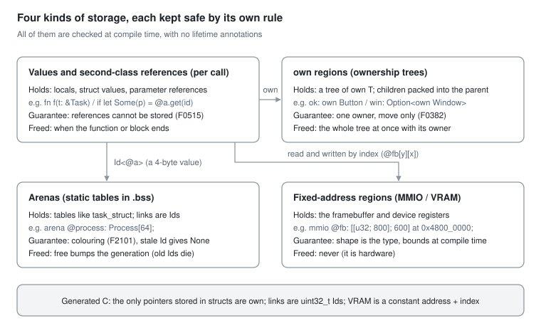
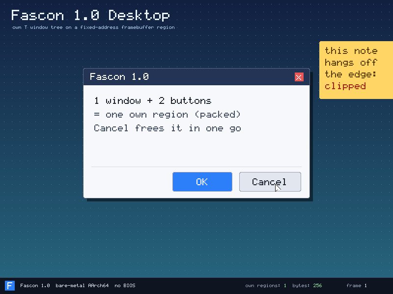
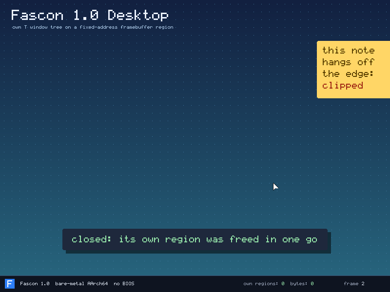

# Fascon 1.0 Specification — multi-arena Ids, generation tags, own T, fixed-address regions

2026-11-06 · Fascon 1.0.0 · 日本語: [SPEC-1.0.ja.md](SPEC-1.0.ja.md)

## Overview



References live only inside the syntactic block that creates them. Every link that outlives a block is an `own` pointer (parent to child), an `Id` (inside a table) or an index (into a fixed-address region). None of them needs a named lifetime.

## Mission 1 — executive summary

In Fascon 1.0, bidirectional and cyclic structures such as task_struct, struct file and inode are written without a single lifetime annotation, and their memory safety is checked at compile time. Three rules make this work.

1. **Structs cannot hold references (second-class references, F0515).** Every long-lived link is an `Id<@arena>`, a 4-byte value. References appear only as function parameters and as `if let` / `match` bindings, and they live exactly as long as the syntactic block that holds them, so there is nothing to name.
2. **Ids are coloured by their arena (F2101, F2102).** Passing an `Id<@file>` to `@process` is a type error. Aliases such as `type FileId<@a: File> = Id<@a>` are also checked against the arena's element type.
3. **Generation tags always tell a stale Id apart.** An Id is 32 bits, "[generation 32-K | index K]". The compiler picks K = ceil(log2(capacity)) for each arena, so the source states no limit: a 65,536-slot arena is exactly 16 | 16, the 64-slot `@process` is 26 | 6, and every arena lasts for about 2.1–4.3 billion allocations. Each free advances that slot's generation by one, so a lookup with an old Id yields `None`. An index access `@a[id]` whose liveness is not proven never branches on the Id: a stale read only sets a latch, a stale write lands on a sentinel slot, and the program stops (panic 0x000D) at the next commit point, before any call, output or return. A reused slot is never confused with its previous occupant (no ABA).

Results with the example kernel `examples/kernel_core.fsc`:

| Item | Result |
| --- | --- |
| Arenas | `@process` 64, `@file` 256, `@inode` 128 slots (23,168 bytes in total, in the 2 MiB-aligned `.bss.fascon_arena`); Ids 26 \| 6, 24 \| 8 and 25 \| 7 bits |
| Generation checks (50) | 9 removed by a static liveness proof, 34 branch-free (sentinel + latch), 7 are `Option` lookups whose `None` arm the source handles; none is an `if (stale) panic()` |
| Bounds checks | 4 at run time; 4 removed statically |
| Lifetime annotations (count of `'`) | 0 |
| QEMU with no BIOS (AArch64, EL1) | `FASCON-KERNEL-OK`, exit code 0 |
| Tests | all 317 pass with `python3 tests/run_tests.py target/release/fascon --qemu` (316 without `qemu-system-riscv64`, which the RISC-V board test needs) |

What "100%" covers is spelled out in the last section, "Guarantees and limits": bit flips from cosmic rays, the C and assembly of the BSP, and a wrong address written in an `mmio` declaration are out of scope.

## Type rules

Safety rests on the six rules below, none of which uses lifetime variables. The lifetime of a reference is the nesting of the syntax itself and the liveness of an arena slot is its generation, so every check is decidable.

**1. Arena colouring.** Ids of different arenas are different nominal types; they can be neither assigned nor compared (F2101).

```math
\frac{\Gamma \vdash e : \mathrm{Id}\langle @a \rangle \qquad @a : T[N]}{\Gamma \vdash @a[e] : T}
\qquad\qquad
a \neq b \;\Rightarrow\; \mathrm{Id}\langle @a \rangle \neq \mathrm{Id}\langle @b \rangle
```

**2. Kind-bounded aliases.** `type FileId<@x: File> = Id<@x>` accepts only arenas whose element type is File (F2102).

```math
\frac{@y : T[N] \qquad T \neq \mathit{File}}{\mathit{FileId}\langle @y \rangle \ \text{is ill-formed}}
```

**3. Second-class references.** The grammar of value types has no references, so an expression that stores a reference in a struct, a return value, an Option or an arena has no type (F0515). `&T` and `&mut T` appear only as parameters (including the parameters of a function pointer type `fn(&mut T)`) and as `if let` / `match` bindings, and always die inside the block that created them. A binding of a place whose type cannot be copied (structs, `own`, and arrays or Options of such types) takes the place by reference — `&mut T` when the place is writable, `&T` otherwise — so writes through it reach the place; a place that can be copied (integers, `bool`, `Str`, Ids, and arrays and Options of these) is bound by value. A binding of an `own` place refers to the contents of the own, as `&mut w.ok` does, so the own itself is replaced by assigning the place (F0507).

```math
\tau ::= \mathtt{u8} \mid \cdots \mid \mathtt{u64} \mid \mathtt{bool} \mid \mathtt{Str} \mid S \mid \mathtt{Option}\langle \tau \rangle \mid \mathtt{own}\ \tau \mid \mathrm{Id}\langle @a \rangle \mid [\tau ; n] \mid \mathtt{fn}(\pi_1, \dots, \pi_k) \to \tau
\qquad
\pi ::= \tau \mid \&\tau \mid \&\mathtt{mut}\ \tau
```

`own τ` owns any value type (`own i32`, `own [u8; 4096]`, `own Str`, `own Option<own Node>`, `own S`), never a reference, `()`, another own or a function pointer (F0515 / F2301). The contents of a non-struct own are reached with `*` (`*ctx.buffer += 1`); the fields of an `own S` are reached directly (`w.ok.label`). A function pointer type is a value type whose parameters π are parameter positions (references allowed) and whose result τ is not (F0515).

**4. Arena effects.** Every function f gets the sets of arenas it reads, writes and frees, E(f) = (R, W, F), computed as the least fixpoint over the call graph. While `&mut @a[_]` is live, calling a function that touches a is rejected; while `&@a[_]` is live, calling a function that writes or frees a is rejected (F2502). Mutably borrowing two slots of the same arena at once is rejected too (F0499).

```math
E(f) \;=\; \mathrm{local}(f) \;\cup \bigcup_{g \,\in\, \mathrm{callees}(f)} E(g)
```

**6. Callbacks are stack_only (F0520).** A function-pointer value only comes from a function name used as a value, so every function g that becomes a callback is known. For each reference parameter x of g an escape summary Esc(g, x) is computed as the least fixpoint over the call graph: Esc(g, x) ≠ ∅ iff x — or a reference made from it (`&mut x.f`, a binding of a place behind it), a value wrapping it (`Some(x)`, a struct or array literal, `own x`) or a local bound to it — flows into the return value, into a place that outlives the call (an arena, a static, MMIO, a port, the target of another reference), into an own region, into a by-value parameter, or into a reference parameter whose own Esc ≠ ∅. A callback must satisfy stack_only(g) ⇔ ∀x. Esc(g, x) = ∅; a violation is F0520, reported with the flow as its root-cause timeline. The higher-order function `for_each(a, f)` that calls `f(&mut a[i])` therefore lends a reference that is used only inside the call [call, ret]. Effects of calls through a function pointer are the union over the functions that can be passed there (rule 4), so F2502 holds for callbacks too.

```math
\mathrm{stack\_only}(g) \iff \forall x \in \mathrm{refparams}(g).\; \mathrm{Esc}(g, x) = \emptyset
\qquad
E(\texttt{f}(\ldots)) \;=\; \bigcup_{g \,\in\, \mathrm{cands}(\texttt{f})} E(g)
```

**5. Generation tags.** An Id is the pair (g, i) packed as g · 2^K + i with K = ceil(log2 N) for an arena of N slots. With g_i the generation of slot i, lookup and free work as follows. Ids are produced only by `alloc` (g ≥ 1) and `validate`, and g_i increases monotonically without wrapping, so an old Id never matches again. A slot that reaches the last generation 2^(32−K) − 1 retires and is never handed out again.

```math
\mathrm{get}(g, i) = \begin{cases} \mathrm{Some}(\mathit{slot}_i) & g = g_i \ne 0 \\ \mathrm{None} & \text{otherwise} \end{cases}
\qquad
\mathrm{free}(i) : \; g_i \leftarrow g_i + 1 \quad (g_i = 2^{32-K} - 1 \Rightarrow \text{retire})
```

**Static removal of checks.** Right after `alloc`, inside `if let Some(_) = @a.get(id)` and at the top of every iteration of `for id in @a`, the Id is proven live; until an effect frees from that arena, no generation check is emitted. A checked access proves nothing for later accesses (it no longer stops on the spot, see "32-bit Ids, the latch and the sum specialization"), except for elements that hold `own`, which do stop on the spot. An index whose range is proven by range analysis gets no bounds check.

| Code | Rejects |
| --- | --- |
| F0001 | source containing `'` (lifetime annotations, character literals) |
| F0382 / F0381 | use after move, use before initialization |
| F0499 / F0502 / F0596 | two mutable borrows, writing while borrowed, writing through a shared reference |
| F0507 | moving a child out of an `own` field, moving a non-copyable value out of `*b`, replacing an `own` through a binding of its place |
| F0515 | storing a reference in a struct, return value, Option, arena or own; a reference as the result of a function pointer type |
| F0520 | a callback letting a reference it received escape (stored, boxed, wrapped, moved into a by-value parameter or returned) |
| F0618 | calling something that is neither a function nor a function pointer `fn(..)` |
| F2030 | a struct that contains itself by value (write recursion as `Option<own T>`) |
| F2031 / F2032 | a malformed `#[repr(align(N))]` (N must be a power of two from 1 to 4096), a type aligned to more than 16 bytes inside `own` |
| F2101 / F2102 | using an Id of another arena, an alias that violates its kind bound |
| F2301 | an own of something an own cannot hold (`()`, `own own T`, a function pointer) |
| F2201 / F2203 | a constant index out of range, overlapping MMIO regions |
| F2502 | calling a function that writes or frees an arena that is currently borrowed |
| F2900 | 0.1-only features (spawn, chan, async, `#[isr]`) in a 1.0 file |

## Mission 1 — the kernel source and the proof of "zero `'`"

`examples/kernel_core.fsc` (392 lines) keeps a cyclic graph across three arenas — child to parent, parent to child list, Process to File to Inode, and the File to Process back link — without a single `'`. The types and arenas:

```rust
type ProcessId<@a: Process> = Id<@a>;
type FileId<@a: File> = Id<@a>;
type InodeId<@a: Inode> = Id<@a>;

struct Inode { ino: u32, size: u64, open_count: u32 }

struct File {                                   // like struct file
    inode: InodeId<@inode>,                     // File -> Inode
    pos: u64,
    refcnt: u32,                                // shared by fork and dup
    opener: ProcessId<@process>,                // File -> Process (back link)
}

struct Process {                                // like task_struct
    pid: u32,
    state: u8,
    exit_code: i32,
    parent: Option<ProcessId<@process>>,        // child -> parent (a cycle)
    first_child: Option<ProcessId<@process>>,   // parent -> children (intrusive list)
    next_sibling: Option<ProcessId<@process>>,
    fds: [Option<FileId<@file>>; NFDS],         // Process -> File
    nfiles: u32,
}

arena @process: Process[64];
arena @file: File[256];
arena @inode: Inode[128];
```

Reparenting the children of an exiting process to init (what Linux does). Ids are values, so the code reads and then writes, and never holds a reference across statements.

```rust
fn exit_task(pid: ProcessId<@process>, code: i32, init: ProcessId<@process>) {
    for fd in 0..NFDS {
        close(pid, fd);
    }
    let mut cur = @process[pid].first_child;
    loop {
        match cur {
            Some(c) => {
                let next = @process[c].next_sibling;
                @process[c].parent = Some(init);
                @process[c].next_sibling = @process[init].first_child;
                @process[init].first_child = Some(c);
                cur = next;
            }
            None => {
                break;
            }
        }
    }
    @process[pid].first_child = None;
    @process[pid].state = TASK_ZOMBIE;
    @process[pid].exit_code = code;
}
```

The ABA check. After pid 12 exits and is reaped, pid 20 takes the same slot 4 with generation 2. A lookup with the old generation-1 Id gives `None`.

```rust
let stale = c;                       // the Id of pid 12 (slot 4, generation 1)
exit_task(b, 0, init);
exit_task(c, 3, init);
reap(shell);                         // free: slot 4 moves to generation 2
let d = spawn_task(20, Some(shell)).unwrap();   // slot 4, generation 2
match @process.get(stale) {
    Some(p) => { /* never reached */ }
    None => print_str("lookup with the stale Id -> None (generation mismatch, no ABA)"),
}
```

That the file contains no `'` at all can be checked mechanically in three independent ways.

1. **The lexical rule.** The Fascon lexer has no token that accepts `'`; any `'` in code is F0001 (`tests/err/f0001_lifetime.fsc` → ``error[F0001]: lifetime annotation `'a` is not allowed``). A file that compiles therefore contains no lifetime annotation.
2. **The compiler's own count.** The last line of `fascon regions examples/kernel_core.fsc` reads "lifetime annotations in the source (count of `'`): 0".
3. **The characters themselves.** `grep -c "'" examples/kernel_core.fsc` prints 0: not even the comments contain a `'` (in Windows PowerShell, `(Select-String -Path examples\kernel_core.fsc -Pattern "'" -SimpleMatch).Count` is 0). The GUI example `examples/gui_desktop.fsc` is 0 as well.

## Mission 1 — the generated C and how it runs

The generated C uses "index + generation" instead of pointers. The only pointers stored in struct fields are `own T` (unique owners); every link between arenas is a 32-bit Id. For the 64-slot `@process` the compiler picks K = 6, so an Id is 26 bits of generation and 6 bits of index.

```c
typedef f20_id_t fsc_Id_process; /* Id<@process>: [generation 26 bits | index 6 bits] (K = 6, 0 = None) */

struct fsc_Process {
    uint32_t pid;
    uint8_t state;
    int32_t exit_code;
    fsc_Id_process parent;        /* Option<Id<@process>> — 0 = None */
    fsc_Id_process first_child;   /* Option<Id<@process>> — 0 = None */
    fsc_Id_process next_sibling;  /* Option<Id<@process>> — 0 = None */
    fsc_Id_file fds[16];          /* [Option<Id<@file>>; 16] — 0 = None */
    uint32_t nfiles;
};

/* arena @process: Process[64] — static, .bss.fascon_arena; live[], gen[] and link[] are kept apart from slot[] (SoA) */
#define ARENA_process_K 6u
#define ARENA_process_CAP 64u
typedef struct F20_ALIGN16 {
    fsc_Process v;
} f20_slot_process_t;                                      /* a slot on a 16-byte boundary */
F20_DEFINE_TABLE(process, ARENA_process_K, f20_gen32_t);  /* st (128 B of its own) | live[1] | gen[64] | link[64] | slot[64 + 1 sentinel], each on a 128-byte boundary */
static f20_arena_t(process) arena_process F20_ARENA_STORAGE(f20_arena_t(process));

/* a read of an unproven @process[id]: the compare only feeds the latch; the slot address does not wait for it */
static inline const fsc_Process *arena_process_at_r(fsc_Id_process id, uint32_t *F20_RESTRICT flt) {
    const uint32_t i = F20_ID_INDEX(id, ARENA_process_K), g = F20_ID_GEN(id, ARENA_process_K);
    *flt |= (uint32_t)(arena_process.gen[i] != g) | (uint32_t)(g == 0u); /* F20_FAULT_STALE */
    return &arena_process.slot[i].v;
}

/* a write or &mut: a wrong generation selects the sentinel slot[2^K] arithmetically */
static inline fsc_Process *arena_process_at(fsc_Id_process id, uint32_t *F20_RESTRICT flt) {
    const uint32_t i = F20_ID_INDEX(id, ARENA_process_K), g = F20_ID_GEN(id, ARENA_process_K);
    const uint32_t bad = (uint32_t)(arena_process.gen[i] != g) | (uint32_t)(g == 0u);
    *flt |= bad; /* F20_FAULT_STALE */
    return &arena_process.slot[(i & (bad - 1u)) | (F20_SENTINEL(ARENA_process_K) & (0u - bad))].v;
}

/* for Ids whose liveness is proven at compile time: one mask, no check */
#define arena_process_slot(id) (&arena_process.slot[F20_ID_INDEX((id), ARENA_process_K)].v)
```

`exit_task` becomes the C below. Its Ids come from outside, so every access is latched instead of checked; if one of them was stale, the function stops at the next `F20_COMMIT`: before the next call to `close`, when the loop is left, or before it returns. The `loop` does not get a commit point of its own at the top of each iteration; the latch only sends it to its exit, where the commit point stops it.

```c
static void fsc_exit_task(fsc_Id_process pid, int32_t code, fsc_Id_process init) {
    uint32_t _flt = 0u; /* deferred faults (the latch) */
    for (uintptr_t fd = 0u; fd < fsc_NFDS; fd++) {
        F20_COMMIT(_flt, "kernel_core.fsc:167:9");   /* before the call */
        (void)fsc_close(pid, fd);
    }
    F20_COMMIT(_flt, "kernel_core.fsc:166:5");       /* at the exit of the fixed-trip loop */
    fsc_Id_process cur = arena_process_at_r(pid, &_flt)->first_child;
    for (;;) {
        if (FASCON_UNLIKELY(!F20_LATCH_OK(_flt))) break; /* latch → loop exit */
        if (cur != 0u) {
            fsc_Id_process c = cur;
            fsc_Id_process next = arena_process_at_r(c, &_flt)->next_sibling;
            arena_process_at(c, &_flt)->parent = init;
            arena_process_at(c, &_flt)->next_sibling = arena_process_at_r(init, &_flt)->first_child;
            arena_process_at(init, &_flt)->first_child = c;
            cur = next;
        } else {
            break;
        }
    }
    F20_COMMIT(_flt, "kernel_core.fsc:171:5");       /* at the loop exit */
    arena_process_at(pid, &_flt)->first_child = 0u;
    arena_process_at(pid, &_flt)->state = fsc_TASK_ZOMBIE;
    arena_process_at(pid, &_flt)->exit_code = code;
    F20_COMMIT(_flt, "kernel_core.fsc:188:1");
}
```

An unproven read and an unproven write of `Task[65536]` (K = 16, so the generations are 16-bit) as emitted by clang 18 (`--target=aarch64-none-elf -mcpu=cortex-a72 -O2`). Neither contains a branch, and the slot address of the read does not depend on the compare. Here `flt` is a pointer argument; inside a function it is a register.

```asm
// read: arena_task_at_r(id, flt)->vruntime
and    w8, w0, #0xffff          // index = id & mask
adrp   x9, arena_task
add    x9, x9, :lo12:arena_task
add    x10, x9, w8, uxtw #1     // &gen[index]
add    x8, x9, w8, uxtw #4      // &slot[index] (does not wait for the compare)
ldrh   w9, [x10, #32]           // gen[index]
mov    w10, #72
movk   w10, #6, lsl #16         // offset of slot[0].v.vruntime
lsr    w11, w0, #16             // generation = id >> K
cmp    w0, #16, lsl #12         // generation != 0 ?
ldr    w12, [x1]
ccmp   w9, w11, #0, hs          // gen[index] == generation ?
cset   w9, ne
orr    w9, w12, w9              // flt |= stale
str    w9, [x1]
ldr    x0, [x8, x10]            // the value
ret

// write: arena_task_at(id, flt)->vruntime = v   (only the end differs)
cset   w10, ne
orr    w10, w12, w10            // flt |= stale
str    w10, [x1]
mov    w10, #65536              // the sentinel's index, 2^K
csel   x9, x10, x9, ne          // stale ? sentinel : index
add    x8, x8, x9, lsl #4
mov    w9, #72
movk   w9, #6, lsl #16
str    x2, [x8, x9]
ret
```

The run on QEMU virt (AArch64, EL1) with no BIOS and no firmware. The kernel image is 51,136 bytes of .text; everything else is NOLOAD: the arenas (23 KB in the 2 MiB-aligned `.fascon_arena`), 13 KB of .bss, a 128 KiB stack, the 1 MiB frame region and the 8 MiB own heap.

```text
$ fascon qemu examples/kernel_core.fsc
[bsp] Fascon 1.0 bare-metal: QEMU virt AArch64, no BIOS / no firmware (EL1)
[bsp] MMU + caches on (identity map, no 4 KiB pages: RAM = one 1 GiB block, 1-level walk)
[bsp] arenas: 3 tables, 0x0000000040200000..0x0000000040205a80 (22 KiB, 2 MiB aligned) -> inside the 1 GiB RAM block (1 TLB entry for all RAM)
[bsp] own heap 8192 KiB, own frame 1024 KiB, kernel image 0x0000000040080000..0x0000000040b2a000
== Fascon 1.0 data-oriented kernel (multi-arena + generational Ids) ==
-- ABA check: the same slot, a new generation --
stale Id of pid 12: slot 4 gen 1   new Id of pid 20: slot 4 gen 2
lookup with the stale Id -> None (generation mismatch, no ABA)
lookup with the new Id   -> pid 20
validate(raw of d) = Some
validate(raw of stale) = None
validate(0xdeadbeef) = None
integrity: refcounts and parent/child links are consistent
FASCON-KERNEL-OK
[bsp] exit code 0
```

(The process tables are left out of this listing.)

Pointer corruption cannot happen by construction. A link is an index masked to the table (`id & (2^K − 1)`), so no Id value of any kind can point outside it, and an Id that names a freed slot always fails the generation compare. And no struct field on the C side is a pointer that can hold an arbitrary address.

## 32-bit Ids, the latch and the sum specialization

The source never states a limit or a width: the compiler derives everything from the declared capacity, and the grammar is the same as before.

| | Rule |
| --- | --- |
| Id | `f20_id_t` (uint32_t, one W register) = [generation 32−K \| index K], K = ceil(log2(capacity)), 1 ≤ K ≤ 24. `F20_ID_INDEX` is one AND, `F20_ID_GEN` one LSR, `F20_ID_MAKE` one ORR with a shift |
| Lifetime | a slot is reused 2^(32−K) − 1 times and then retires; an arena serves capacity × (2^(32−K) − 1) allocations: 4,294,901,760 for 65,536 slots (16 \| 16), 4,294,967,232 for the 64-slot `@process` (26 \| 6), at least about 2.15 billion for any capacity |
| Table | 2^K slots plus one sentinel slot. `gen[]` uses the narrowest type that holds the generation (8, 16 or 32 bits). The bookkeeping `st` has a 128-byte block of its own, then come the live bitmap `live[]` (one bit per slot), `gen[]`, `link[]` and `slot[]`, each starting on a 128-byte boundary. Slots are aligned to 16 bytes (N bytes with `#[repr(align(N))]` on the element). Tables live in `.bss.fascon_arena`; those of 1 MiB or more start on a 2 MiB boundary |
| Columns | for every `for id in @a` reduction the compiler adds a column right after `live[]` (`F20_DEFINE_TABLE_COLS`): an aggregate column `filter ? value : 0` for sums, a bit column `live && filter` for filtered counts, a key column `live && filter ? enc(value) : NONE` for min / max picks. The slot stays authoritative; the columns are rebuilt at alloc, free / remove, writes by Id that reach a field they read, every exit of a `get_mut` scope and after calls given `&mut @a[id]`. Not for filters that read a local variable or 64-bit `<=` / `>=` picks. `--columns off` gives the tables without columns (PERF-1.0.md, phase 4). **True SoA (the default `--columns on`):** a 32- / 64-bit integer field that reductions read as a value leaves the slot, and its column `ts_f[]` (with the sentinel `col[max(2^K, 64)]`) becomes the only copy, when the table and element qualify (a table arena whose element is not `#[stable_abi]`, `#[wire]`, `#[secret]` or `#[repr(align)]` and holds no own, neither the element type nor an Id of the table crosses `extern "C"`, no element reference escapes, and the field's address is never taken and it is in no filter). A write is one store to the column; alloc writes initial values to the columns, free / remove zero them, and `#[on_drop]` sees a value rebuilt from them. Other fields keep mirrored columns; write-heavy fields that cannot be True SoA (write weight above scan weight) get none. `--columns mirrored` gives mirrored columns only (the phase-4 C). Bulk overwrites use non-temporal stores under `--nontemporal=auto\|on\|off` (PERF-1.0.md, phase 5) |
| Bounds | the index is `id & (2^K − 1)` and the table has 2^K + 1 slots, so no Id value can address outside it: there is no bounds compare to remove |
| Empty | the all-zero state (.bss) is an empty arena; dead, unused and padding slots are always zero |

How each access is checked:

| Access | Generated C | Branch on the Id |
| --- | --- | --- |
| `@a[id]`, liveness proven (the `for` variable, right after `alloc`, inside `if let Some`) | `arena_a_slot(id)`: one mask | none |
| `@a[id]` read, not proven | `arena_a_at_r(id, &_flt)`: the address comes from the index, the generation compare is OR-ed into `_flt` | none |
| `@a[id]` write or `&mut`, not proven | `arena_a_at(id, &_flt)`: a wrong generation selects the sentinel `slot[2^K]` arithmetically | none |
| `@a.get(id)`, `if let`, `match` | compare and branch; the `None` arm is the one written in the source | the source's own |
| `@a[id]` on elements that hold `own` | stops on the spot (panic 0x000D); a sentinel would break the uniqueness of `own` | one, never taken in a correct program |

A latched fault stops the program at the next commit point, `F20_COMMIT(_flt, site)`: right before a call to another function, before output, MMIO and `exit`, before `return`, and where a loop is left. Values read through a stale Id come from inside the table and have the right type, and no real slot is ever written through one, so the stop happens with memory intact and before anything outside the function can observe the fault. A loop with a fixed trip count (`for i in a..b`, `for id in @a`) has no commit point inside: every external effect in its body has its own, and the loop always ends, so one check at the exit gives the same guarantee and leaves the body without that jump (and open to vectorization). A loop without a fixed trip count (`while`, `loop`) folds the latch into its exit test (`F20_LATCH_OK`), so the check shares the exit's branch. A commit point is one `cbnz` on a register, once per call, return or loop rather than per access; it is emitted only in functions that use the latch, and GCC and Clang drop those they can prove are zero.

`for id in @a` gets one more treatment. Freeing a slot fills it with zeros, so the sum over the first n slots (n = `next_unused` rounded up to 4, never more than 2^K) is the sum over the live slots, without reading `link[]` and without a branch. When the body of the loop only adds unsigned integer fields of the slot (directly, or through `if let Some(t) = @a.get(id)`, with widening casts) into an unsigned variable declared outside the loop, the compiler emits one scan function and replaces the loop with a call. The same holds when the addition sits under a filter (`if cond { .. }`), when a constant is added (a count) and for a running minimum or maximum with its Id (`if t.v < best { best = t.v; pick = Some(id); }`): the filter becomes an all-ones / all-zeros mask, and counts and minima exclude dead slots with the live bitmap, so the scan has no branch apart from its back edge. Any other body keeps the general loop, which reads the live bitmap one 64-slot word at a time and finds the next live slot with ctz (TZCNT on x86-64, RBIT + CLZ on AArch64) instead of testing `link[]` slot by slot. The details, generated code and measurements are in [PERF-1.0.md](PERF-1.0.md).

```rust
// examples/vruntime_scan.fsc
arena @task: Task[65536];       // K = 16: Id = [generation 16 bits | index 16 bits]

fn total_vruntime() -> u64 {
    let mut total: u64 = 0;
    for id in @task {
        total += @task[id].vruntime;
    }
    total
}
```

The C below is the output of `fascon build examples/vruntime_scan.fsc --columns off` (the scan without columns), and the GCC loop after it is the loop of that function. With the default `--columns on`, `fsc_reduce_task_1` reads a column instead of the slots and is one call, `f20_col_sum_u64(arena->col.agg0_vruntime, arena->live, n, flt)` ([PERF-1.0.md](PERF-1.0.md), phase 4).

```c
static FASCON_MAYBE_UNUSED uint64_t fsc_reduce_task_1(const f20_arena_t(task) *__restrict__ arena, uint32_t *__restrict__ flt, uint64_t acc) {
    const uint32_t n = (arena->st.next_unused + 3u) & ~3u; /* rounded up to a multiple of 4 (≤ 2^K; slots from next_unused on were never used and are zero) */
    const f20_slot_t(task) *p = arena->slot, *const end = arena->slot + n;
    uint64_t lo0 = 0u, lo1 = 0u, lo2 = 0u, lo3 = 0u; /* sums of the low 32 bits */
    uint64_t hi0 = 0u, hi1 = 0u, hi2 = 0u, hi3 = 0u; /* sums of the high 32 bits */
    for (; p < end; p += 4) {
        lo0 += (uint32_t)p[0].v.vruntime; hi0 += (uint64_t)p[0].v.vruntime >> 32;
        lo1 += (uint32_t)p[1].v.vruntime; hi1 += (uint64_t)p[1].v.vruntime >> 32;
        lo2 += (uint32_t)p[2].v.vruntime; hi2 += (uint64_t)p[2].v.vruntime >> 32;
        lo3 += (uint32_t)p[3].v.vruntime; hi3 += (uint64_t)p[3].v.vruntime >> 32;
    }
    const uint64_t lo = (lo0 + lo1) + (lo2 + lo3);
    const uint64_t hi = (hi0 + hi1) + (hi2 + hi3) + (lo >> 32);
    const uint64_t sum = (hi << 32) | (lo & 0xFFFFFFFFu);
    uint64_t r;
    const uint32_t ov = (uint32_t)((hi >> 32) != 0u) | (uint32_t)__builtin_add_overflow(acc, sum, &r);
    *flt |= ov << 1; /* F20_FAULT_ARITH */
    return r;
}

static uint64_t fsc_total_vruntime(void) {
    uint32_t _flt = 0u; /* deferred faults (the latch): 0 = healthy; checked at commit points (right before external effects and returns, and at loop exits; while / loop also fold it into their exit test) */
    uint64_t _rv1;
    uint64_t total = UINT64_C(0);
    /* for .. in task: sum specialization (fsc_reduce_task_1) */
    total = fsc_reduce_task_1(&arena_task, &_flt, total);
    _rv1 = total;
    F20_COMMIT(_flt, "vruntime_scan.fsc:26:1");
    return _rv1;
}
```

The loop as emitted by GCC 13.3 (`aarch64-linux-gnu-gcc -O2`): four slots per trip, 15 instructions, and the only branch is the back edge. `add x3, x3, w7, uxtw` and `add x8, x8, x7, lsr 32` each add one half in a single instruction.

```asm
.L10:
ldr   x7, [x2, 8]               // slot k: vruntime
add   x2, x2, 64                // 4 slots × 16 bytes
ldr   x6, [x2, -40]
ldr   x5, [x2, -24]
add   x3, x3, w7, uxtw          // lo0 += low 32 bits
ldr   x4, [x2, -8]
add   x8, x8, x7, lsr 32        // hi0 += high 32 bits
add   x14, x14, w6, uxtw
add   x12, x12, x6, lsr 32
add   x10, x10, w5, uxtw
add   x9, x9, x5, lsr 32
add   x13, x13, w4, uxtw
add   x11, x11, x4, lsr 32
cmp   x15, x2
bhi   .L10
```

Clang 18 vectorizes the same function into a NEON loop of 16 slots per trip followed by a scalar loop of 4; both are branch-free apart from the back edge. Overflow stays exact: each half-sum stays below 2^56 for at most 2^24 slots, the halves are recombined once at the end, and because the values are unsigned, "some partial sum overflowed" is the same condition as "the exact total does not fit", so the result and the stop match the sequential checked additions. The overflow bit goes into the latch (panic 0x000B at the commit point).

### Measurements

The traversal benchmark sums vruntime over 60,000 task_struct-like Tasks (`bench/sched_bench.fsc`, `bench/harness.c`; 32-byte slots, K = 16). The Fascon side calls the generated C unchanged; the baseline is ordinary C that allocates the same Task with malloc and links it with raw pointers. Both versions of the compiler were measured in the same session, alternating runs, so that the machine's drift affects both.


*bench/harness.c · Intel Xeon 6 (Granite Rapids) 2.3 GHz, KVM, L2 2 MiB per core · 60,000 tasks · median of 5 alternating runs, each a 15-run median · ns per task*

| Traversal | 1.0 preview, gcc | 1.0.0, gcc | 1.0 preview, clang | 1.0.0, clang |
| --- | --- | --- | --- | --- |
| C pointers, packed malloc, creation order | 2.98 | 2.86 | 2.84 | 2.86 |
| Fascon `get` chain, creation order | 4.25 | 3.82 | 5.33 | 5.35 |
| Fascon `@task[id]` chain, creation order | 4.31 | 3.70 | 5.27 | 5.45 |
| Fascon `for id in @task` scan | 1.38 | 0.94 | 1.25 | 0.91 |
| C pointers, packed malloc, scattered | 55.89 | 55.61 | 60.12 | 55.33 |
| C pointers, fragmented malloc, scattered | 78.11 | 78.58 | 76.84 | 76.22 |
| Fascon `get` chain, scattered | 44.98 | 28.95 | 39.97 | 44.87 |
| Fascon `@task[id]` chain, scattered | 35.93 | 33.52 | 41.70 | 28.57 |

What the numbers say, and what they do not:

- The table scan became 20–32 % faster (the sum specialization). In an earlier, quieter session the same 1.0.0 scan measured 0.48–0.70 ns per task; 0.9 ns is about 2 cycles at 2.3 GHz, so "less than one cycle per task" was not reached on this machine. On AArch64 the loop is 3.75 instructions per slot (GCC); it was not timed on real AArch64 hardware.
- The `@task[id]` chain is branch-free (latched) and is as fast as the `get` chain, or faster: removing the branch on the Id did not cost anything measurable.
- The scattered rows move by up to ±40 % between runs on this virtual machine; the working set (1.9 MB of slots and 128 KiB of generations) sits at the size of L2, so a threshold effect is part of every scattered number. On a list allocated contiguously in creation order, raw pointers stay faster.

**November 2026 update (same version).** The table above was measured for the 1.0.0 release. After the changes in [PERF-1.0.md](PERF-1.0.md) (live bitmap, masked reductions, commit points moved out of fixed-trip loops, 2 MiB pages) the same benchmark was run on another machine (Intel Xeon @ 2.10 GHz, KVM), alternating the 1.0.0 output and the new output. The plain `for id in @task` sum went from 0.74 / 0.71 ns to 0.63 / 0.57 ns per task (GCC / clang), that is 1.32 / 1.20 cycles; filtered counts and pick_next went from 1.10–1.31 ns to 0.69–0.73 ns. Under one cycle per task was still not reached. All rows are in [bench/RESULTS.md](../bench/RESULTS.md).

**Columns (same version).** With the columns of PERF-1.0.md phase 4 the scans read only the values each reduction uses. Measured later on another host (core clock 3.85 GHz, median of 9 alternating rounds of `--columns off` / `on`, GCC and clang, SSE2 and `-march=native`): the plain sum went from 0.45–0.54 to 0.10–0.21 ns per task, the filtered sum from 0.48–0.82 to 0.05–0.10 ns, pick_next from 0.49–0.63 to 0.07–0.21 ns and the filtered count from 0.28–0.60 to 0.00–0.02 ns, that is 0.19–0.81 cycles per 32-byte task in every build. A loop writing a field the columns read in every runnable task took about twice as long. The True SoA of PERF-1.0.md phase 5 removes that dual write (another host, 2.87–3.27 GHz, against hand-written C (AoS): with 60,000 tasks, bulk updates and overwrites of every task take 0.44–0.86× the C time, the write to runnable tasks only 0.97–1.03× with GCC and 1.47–1.90× with clang, and reads stay under one cycle in every build; with 4 million tasks bulk updates and overwrites take 0.10–0.24× and reads 0.01–1.03 cycles).

## Mission 2 — fixed-address regions and own T


VRAM and device registers are declared as fixed-address regions and read and written by index, with no raw pointers and no `unsafe`. The tree of on-screen parts is held with `own T`; dropping a parent frees all of its descendants at once.

```rust
#[framebuffer]
mmio @fb: [[u32; 800]; 600] at 0x4800_0000;
mmio @uart: [u32; 18] at 0x0900_0000;          // PL011: DR = [0], FR = [6] (0x18 / 4)

struct Rect { x: i32, y: i32, w: i32, h: i32 }

struct Button {
    label: Str,
    rect: Rect,
    primary: bool,
    pressed: bool,
}

struct Window {
    title: Str,
    rect: Rect,
    line1: Str,
    line2: Str,
    line3: Str,
    ok: own Button,          // the window owns its buttons
    cancel: own Button,
}

struct Desktop {
    win: Option<own Window>,
    note: Str,                 // the notice shown when no window is open
    frame: u32,
}
```

**Rules for fixed-address regions (`mmio`)**

- The shape is the type. In `@fb[y][x]`, y is 0–599 and x is 0–799. A constant out of range is a compile error (F2201).
- An index whose range is proven (`for y in 0..600` and the like) is not checked. An index that cannot be proven costs one compare and panics with 0x000C when out of range. `put(x, y, v)` and `fill_rect(x, y, w, h, v)` clip instead of writing.
- Overlapping regions are a compile error (F2203). An overlap with the kernel image is caught by the BSP at boot (panic 0x2203).
- `#[framebuffer]` regions are normal memory; all other regions are device memory and go through `fascon_mmio_read` / `write` (the same ordering as Linux readl / writel).
- There is no syntax that takes a pointer out of a region, and a region cannot be passed as a value. It is used everywhere by its name, `@fb`.
- The address from the brief, 0x3c000000, is declared the same way (`at 0x3c00_0000`). On QEMU virt, however, that address is the PCIe window and not RAM, so the example places the framebuffer at 0x4800_0000 in RAM, where ramfb scans it out.

**Rules for `own T`**

- The contents of an own can be any value type: `struct MyContext { buffer: own i32, size: i32 }`, `own [u8; 4096]`, `own Str`, `Option<own i32>`, `own_alloc([u8; 64])`. A non-struct own is read and written through `*` (`*ctx.buffer = 7;`, `let v = *ctx.buffer;`); `ctx.buffer = own 7;` replaces the whole own and frees the old one. In C an `own i32` is an `int32_t *` and an `own [u8; N]` a `uint8_t *` to the first element, both in an own region with the same 16-byte header.
- A struct that holds own fields is itself move-only. Moving it hands the owns over (the source is cleared, so dropping it does nothing); its scope end, an overwrite, `drop(x)` or the arena free of its slot runs its drop glue, which frees every own inside (`fsc_drop_MyContext` → `fsc_own_drop_T_i32` → `fascon_own_free`). Use after move — including a field access or a write through `*` — is F0382; moving an own field (or a non-copyable `*b`) out is F0507. Both are flow checks over every path (branches, loops, `break`, `return`), so a double free cannot be written.
- `own Window { .. }` creates one own region. The non-Option `own` children built inside that expression (the OK and Cancel buttons) are packed into the same block, so there is one allocation.
- An own value can only be moved. Use after move is F0382; moving a child out of an `own` field is F0507 (make a detachable child `Option<own T>` and use `.take()`). Recursive types are written with `Option<own T>` (F2030).
- It can be lent to a parameter as `&w`. References are second-class, so the borrower can never store it.
- Allocation has a 16-byte header and takes O(1) from 12 size-class free lists covering 32 bytes to 64 KiB.
- A `let x = own T { .. }` that escape analysis shows is never moved is taken from a frame region instead: one bump of the frame's top pointer, popped back to its mark where x's scope ends (break, continue and return included). Returned, stored or dropped values stay on the heap ([PERF-1.0.md](PERF-1.0.md)).

**Rules for bulk freeing**

1. At the end of a scope, on overwrite (`desk.win = None`) or with `drop(x)`, the root block is returned once.
2. Freeing a packed child does nothing (its header is marked EMBEDDED). `Option<own T>` children are freed first.
3. A list that links to its own type is freed iteratively, so even a long list uses no stack.
4. In the GUI example the window and its two buttons are one 256-byte block; pressing Cancel takes the number of own blocks from 1 to 0.

**Booting with no BIOS (the bundled BSP)**

QEMU loads the ELF and jumps straight to its entry point; no firmware runs at all. `start.S` lets only CPU0 continue, drops from EL2 to EL1 if needed, sets up the stack, FP/SIMD and the exception vectors, and zeroes .bss and the arena section. `bsp.c` turns on an identity-mapped MMU with no 4 KiB pages: without a framebuffer, RAM is one 1 GiB block (a one-level walk); with one, RAM is mapped in 2 MiB blocks, the framebuffer's blocks are Normal non-cacheable, and every uniform, 32 MiB-aligned group of 16 blocks carries the contiguous hint. The tables are written once at boot and never changed. It then reads the MMIO region table of the generated C, configures ramfb (800×600 XRGB8888) through fw_cfg, registers the own heap and the frame region, and calls `fascon2_main`.

## Mission 2 — the GUI kernel source and its screen

`examples/gui_desktop.fsc` (391 lines, including a 760-byte 8×8 font table) boots with no BIOS, initializes the framebuffer and draws a window with two buttons. The window is created with one allocation and freed in one go by Cancel. It contains no `'`.

```rust
fn open_window() -> own Window {
    // the window and its two buttons go into one own region with a single allocation
    own Window {
        title: "Fascon 1.0",
        rect: Rect { x: 170, y: 140, w: 460, h: 264 },
        line1: "1 window + 2 buttons",
        line2: "= one own region (packed)",
        line3: "Cancel frees it in one go",
        ok: own Button { label: "OK", rect: Rect { x: 352, y: 352, w: 120, h: 38 }, primary: true, pressed: false },
        cancel: own Button { label: "Cancel", rect: Rect { x: 488, y: 352, w: 124, h: 38 }, primary: false, pressed: false },
    }
}

fn draw_wallpaper() {
    // the ranges of y and x (0..600, 0..800) match the shape of @fb, so the bounds checks vanish statically
    for y in 0..600 {
        let c = wallpaper(y);
        for x in 0..800 {
            @fb[y][x] = c;
        }
    }
}
```

The flow of `main`. Each `FASCON-GUI-READY n` on the UART marks a finished screen; a key press moves on.

```rust
let mut desk = Desktop { win: None, note: "", frame: 0 };
desk.win = Some(open_window());          // one own block (256 bytes)
desk.frame = 1;
render(&desk);
report("FASCON-GUI-READY 1", &desk);
wait_key();

let mut clicked = false;
if let Some(w) = desk.win {
    if hit(&w.cancel, 560, 376) {
        w.cancel.pressed = true;
        draw_button(&w.cancel);
        clicked = true;
    }
}
if clicked {
    desk.win = None;                     // the own region is bulk-freed here (own blocks 1 -> 0)
    desk.note = "closed: its own region was freed in one go";
}
```

The serial output from QEMU (`fascon qemu examples/gui_desktop.fsc --screenshot shot.png --frames 3`):

```text
[bsp] MMU + caches on (identity map, no 4 KiB pages: RAM in 2 MiB blocks, 31 of 32 groups contiguous = 32 MiB TLB entries; framebuffer pages are Normal non-cacheable)
[bsp] ramfb: 800x600 XRGB8888 at 0x0000000048000000 (@fb)
FASCON-GUI-READY 1 frame=1 own_blocks=1 own_bytes=256
window closed: own blocks 1 -> 0
FASCON-GUI-READY 2 frame=2 own_blocks=0 own_bytes=0
FASCON-GUI-READY 3 frame=3 own_blocks=1 own_bytes=256
```

The two screens below were saved from the ramfb of BIOS-less QEMU virt with a QMP screendump: the window open (frame 1) and after Cancel closed it (frame 2). The sticky note at the top right is clipped at the edge of the screen; not a single pixel is written outside it.





## Mission 2 — the generated C and the cost of VRAM writes

Writes to VRAM compile to the same machine code as a loop written by hand with a raw pointer. In both, the inner loop that paints the wallpaper writes 80 pixels (320 bytes) in 13 instructions, none of them a check.

A fixed-address region becomes C with nothing but a constant address and a shape (the address is swapped only when running on a PC).

```c
/* ───── mmio @fb: [[u32; 800]; 600] at 0x48000000 — normal memory (framebuffer: write combining and vectorization allowed), 1920000 bytes ───── */
#if defined(FASCON2_HOSTED_MMIO)
#define MMIO_FB_BASE (fascon2_host_mmio_base[0]) /* PC run: address chosen by the platform layer */
#else
#define MMIO_FB_BASE ((uintptr_t)0x48000000u)
#endif
#define MMIO_FB_W 800u
#define MMIO_FB_H 600u
static inline uint32_t *mmio_fb_ptr(uintptr_t y, uintptr_t x) { return (uint32_t *)MMIO_FB_BASE + y * 800u + x; }
#define MMIO_FB_LEN 480000u

/* line 67: fn draw_wallpaper */
static void fsc_draw_wallpaper(void) {
    for (int32_t y = 0; y < 600; y++) {
        uint32_t c = fsc_wallpaper(y);
        for (int32_t x = 0; x < 800; x++) {
            (*mmio_fb_ptr((uintptr_t)y, (uintptr_t)x)) = c;
        }
    }
    /* … */
}
```

For comparison, the same picture written by hand with a raw pointer (`bench/vram_raw.c`):

```c
#define FB ((uint32_t *)0x48000000u)
void raw_wallpaper(void) {
    for (int32_t y = 0; y < 600; y++) {
        uint32_t c = rgb(lerp(18, 40, y, 599), lerp(32, 104, y, 599), lerp(64, 128, y, 599));
        uint32_t *row = FB + y * 800;
        for (int32_t x = 0; x < 800; x++) row[x] = c;
    }
}
```

The inner loop as emitted by clang 18 (`--target=aarch64-none-elf -mcpu=cortex-a72 -O2`). The only differences between the Fascon and the hand-written versions are the branch addresses and where the alignment nops sit.

```asm
loop:
add   x14, x9, x13
stp   q0, q0, [x14, #-0xa0]     // 128 bits x 2 = 8 pixels
stp   q0, q0, [x14, #-0x80]
stp   q0, q0, [x14, #-0x60]
stp   q0, q0, [x14, #-0x40]
stp   q0, q0, [x14, #-0x20]
stp   q0, q0, [x14]
stp   q0, q0, [x14, #0x20]
stp   q0, q0, [x14, #0x40]
stp   q0, q0, [x14, #0x60]
add   x13, x13, #0x140          // advance 320 bytes = 80 pixels
cmp   x13, #0xc80               // one row = 3200 bytes
stp   q0, q0, [x14, #0x80]
b.ne  loop
```

Device regions are handled differently from normal memory. `@uart[6]` in `wait_key` becomes a volatile load followed by `dmb oshld`, which the compiler neither merges nor reorders.

```c
static void fsc_wait_key(void) {
    for (;;) {
        if ((fascon_mmio_read32(mmio_uart_addr((uintptr_t)6)) & 0x10u) == 0u) {
            uint32_t c = fascon_mmio_read32(mmio_uart_addr((uintptr_t)0));
            if (c != 0xffffffffu) {
                return;
            }
        }
        fascon_cpu_relax();
    }
}
```

An out-of-range write to the screen "cannot happen" because there are only three ways to write: an index whose range is proven, an index checked at run time, and the clipping `put` / `fill_rect`. The 4 bounds checks left at run time in this example are all in the font table and the digit buffer; none is on a VRAM write. If the address or size written in an `mmio` declaration does not match the real hardware, however, the compiler cannot know.

## Guarantees and limits

In code written in Fascon, the errors in the table below cannot happen by construction. "100%" assumes, however, that the hardware works correctly and that the hand-written BSP and runtime are correct.

| Cannot happen | Mechanism |
| --- | --- |
| Dangling references | references cannot be stored (F0515); their lifetime is the syntactic block |
| Use after free and double free of own | move-only, unique owner (F0382, F0507); freed exactly once, when the owner goes away — also for structs holding own fields of any type (`own i32`, `own [u8; N]`) |
| References escaping through callbacks | references are second-class (F0515) and callbacks must be stack_only (F0520); calls through function pointers carry the union of the candidates' effects (F2502) |
| Use of a stale Id, ABA | generation tags: `get` gives None; an unproven `@a[id]` reads inside the table, writes to the sentinel slot and stops (panic 0x000D) at the next commit point; generations never wrap and exhausted slots retire |
| An Id addressing outside its table | the index is `id & (2^K − 1)` into a table of 2^K + 1 slots, for every possible Id value |
| Mixing up Ids of different arenas | coloured types (F2101, F2102) |
| Freeing or rewriting while borrowed | arena effects (F2502) and borrow checks (F0499, F0502, F0596) |
| Out-of-range access to arrays and VRAM | no check when proven, otherwise one compare (panic 0x000C); `put` / `fill_rect` clip; a constant out of range is F2201 |
| Integer overflow | checked arithmetic (panic 0x000B); a sum specialization checks the exact total once and stops at the commit point |
| Lifetime annotations | there is no `'` in the lexical grammar (F0001) |

What is not prevented, or not done yet:

1. **Hardware faults.** Bit flips in RAM, from cosmic rays or otherwise, are not prevented. The generation check guarantees against a program using an old Id; a corrupted Id that happens to name another live slot passes. That is the job of ECC memory and similar hardware.
2. **Hand-written C and assembly.** The BSP (`start.S`, `bsp.c`) and the runtime (`fascon2_rt.h`) are outside Fascon's checks. They were checked with tests, AddressSanitizer and UBSan only, not formally verified.
3. **The address and size in an `mmio` declaration.** The compiler trusts the declaration. Overlaps are checked at compile time and at boot, but a declaration that does not match the real hardware is not detected.
4. **Stack overflow.** Recursion depth is not limited, and the BSP stack (128 KiB) has no guard page.
5. **Finite, and rounded up.** An arena serves about 2.1–4.3 billion allocations, then has no slots left (retired slots are never reused); a kernel that allocates more than that from one arena over its uptime needs a second arena. The table is rounded up to 2^K slots plus one sentinel (a 60,000-slot arena takes 65,537 slots of .bss; the padding is never touched), and one arena holds at most 16,777,216 slots (24 index bits).
6. **A panic is still a stop, and a latched one comes a little later.** Checks that could not be proven stop safely when they fail; memory is not corrupted, but the kernel halts. A latched fault stops at the next commit point instead of at the faulty access: the code in between runs on values read through the stale Id (from the table and of the right type) but cannot write a real slot, call, print or return. Each commit point is one predicted branch on a register (`cbnz`), so "no branch" holds for every access, not for every call and loop. Inside a loop with a fixed trip count the stop comes at the loop exit, so a long loop runs to its end on such values before stopping (still without writing a real slot or doing anything visible outside). `Option` lookups keep their branch, because the source branches on them anyway.
7. **Two engines.** Files that use 1.0 syntax go to the 1.0 engine; all others go to the bundled 0.1.0 engine (`fascon-core`). spawn, chan, async and `#[isr]` cannot be used in a 1.0 file (F2900). Interrupts and multiple cores use the 1.0 forms instead: `irq`, `critical` and `task_arena` ([SPEC-1.0-KERNEL.ja.md](SPEC-1.0-KERNEL.ja.md)), and per-core arenas, `shared arena`, channel declarations such as `chan work: own TaskPacket[8];` and `spawn_on` ([SPEC-1.0-SMP.ja.md](SPEC-1.0-SMP.ja.md), [SPEC-1.0-INTEGRATION.md](SPEC-1.0-INTEGRATION.md)).
8. **Cache numbers.** They were measured on one virtual machine. The difference comes from density and layout: for a pointer list allocated contiguously in creation order, raw pointers are faster, so the arena is not faster in every case.
9. **What was checked.** Runs were checked on QEMU virt (Cortex-A72) with the Linux x64 build of the tools. The Windows, macOS and Linux arm64 builds were cross-compiled. The Windows build was run under Wine and the Linux arm64 build under qemu-user: for all 247 programs of `examples/` and `tests/` in five modes (the default, `--columns mirrored`, `--columns off`, `--nontemporal on`, `--lang ja`) they gave byte-identical C, or the same failure, as the Linux x64 build. The macOS build was not run, and none of the three was run on its own hardware. Real boards (Raspberry Pi and others) use different addresses and a different way to set up the screen, so the BSP needs rewriting.

## Distribution and usage

There are six files. With VS Code the `.vsix` alone is enough: it contains the executables for Windows, Linux and macOS.

| File | Contents |
| --- | --- |
| `fascon-1.0.0.vsix` | VS Code extension with `fascon` (1.0) and `fascon-core` (0.1.0) for Windows x64, Linux x64 / arm64 and macOS Universal |
| `fascon-1.0.0-windows-x64.zip` | `fascon.exe`, `fascon-core.exe`, headers, BSP, examples, documentation |
| `fascon-1.0.0-linux.tar.gz` | `fascon` and `fascon-core` for x64 and arm64, the 0.1 runtime libraries, headers, BSP, examples, documentation |
| `fascon-1.0.0-macos-universal.tar.gz` | `fascon` and `fascon-core` for Intel and Apple silicon, headers, BSP, examples, documentation |
| `fascon-1.0.0-src.zip` | the compiler (Rust, no external crates), runtime, BSP, tests, benchmark, extension source, this specification |
| `SHA256SUMS.txt` | SHA-256 of the five files above |

First run on Windows:

1. **Install the extension.** In VS Code, open the Extensions view (Ctrl+Shift+X), choose "…" at the top right, then "Install from VSIX…", and pick `fascon-1.0.0.vsix`.
2. **Install QEMU and LLVM.** Run these two lines in PowerShell, then reopen VS Code.

    ```powershell
    winget install --id SoftwareFreedomConservancy.QEMU -e
    winget install --id LLVM.LLVM -e
    ```

3. **Check the tools.** Run "Fascon: Show Version and Tool Check" from the Command Palette (Ctrl+Shift+P). You are ready when the lines "C compiler for AArch64" and "QEMU" show `[OK]`.
4. **Open an example.** Run "Fascon: Open a 1.0 Example (kernel / GUI / dual-architecture / BIOS / Rust style / app / callbacks)", choose `gui_desktop.fsc` and pick where to save it.
5. **Boot it in QEMU.** "Fascon: Boot in QEMU (target from settings; portable = BIOS-less AArch64)" (Ctrl+Alt+Q) shows the screen in the QEMU window. Press a key in the VS Code terminal to click Cancel and close the window; press again to reopen it. Close the QEMU window to quit.
6. **Save the screens as images.** "Fascon: Boot in QEMU and Save Screenshots (headless, target from settings)" writes `gui_desktop-qemu-1.png` to `-3.png` into the `build` folder and opens them in VS Code.

From the command line (the same on every OS):

```text
fascon doctor                                      check that the tools needed are installed
fascon check examples/kernel_core.fsc              check only
fascon regions examples/kernel_core.fsc            arenas, own and MMIO, and how many checks were removed
fascon build examples/kernel_core.fsc              build/kernel_core.fascon.c and fascon2_rt.h
fascon qemu examples/kernel_core.fsc               boot on BIOS-less AArch64
fascon qemu examples/gui_desktop.fsc --screenshot shot.png --frames 3
fascon run examples/gui_desktop.fsc                run on the PC (the screen goes to build/gui_desktop.png)
fascon explain examples/errors/f2101_color.fsc     root cause, how to fix it, mathematical explanation
```

- Checking the checksums: `Get-FileHash fascon-1.0.0.vsix -Algorithm SHA256` in PowerShell, `sha256sum -c SHA256SUMS.txt` on Linux, `shasum -a 256 -c SHA256SUMS.txt` on macOS.
- The executables are not code-signed. On macOS, when using the tar.gz, `xattr -d com.apple.quarantine fascon fascon-core` may be needed.
- To build from source: `cargo build --release` (Rust 1.74 or later, no external crates). Tests: `python3 tests/run_tests.py target/release/fascon --qemu`.
